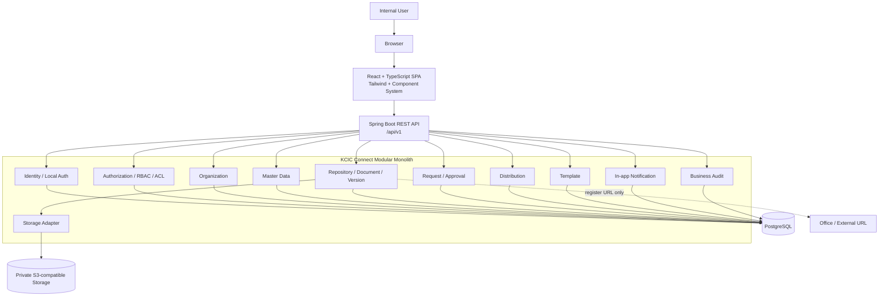

# KCIC Connect — Architecture Document

| Metadata | Nilai |
|---|---|
| Product | KCIC Connect |
| Document | Software Architecture Document |
| Version | 1.0 |
| Status | Baseline arsitektur untuk implementasi pilot |
| Tanggal | 22 November 2026 |
| Bahasa | Indonesia |
| Referensi | `PRD.md`, `SCHEMA.md`, `DESIGN_SYSTEM.md`, `AGENTS.md` |

---

## 1. Tujuan dan Prinsip Arsitektur

Dokumen ini menetapkan batas sistem dan keputusan teknis agar implementasi KCIC Connect tidak berkembang menjadi kumpulan halaman, endpoint, dan tabel yang saling terikat tanpa aturan.

KCIC Connect adalah **internal document governance platform**. Produk harus mampu mengelola identitas dokumen, binary file/link, metadata, versi, hak akses, proses permintaan, distribusi, template, notifikasi, dan audit history.

Prinsip arsitektur:

1. **Modular monolith:** satu aplikasi backend/deployable dengan domain module dan ownership yang eksplisit.
2. **Backend authority:** backend menjadi satu-satunya otoritas untuk authentication, authorization, workflow transition, dan data integrity.
3. **PostgreSQL source of truth:** metadata, identity, organization, permission, workflow, notification, dan audit berada di PostgreSQL.
4. **Object storage for binary:** file disimpan di private S3-compatible object storage (MinIO sebagai baseline deployment yang direkomendasikan).
5. **Document identity != version:** identitas dokumen stabil; revisi membuat document version baru dan tidak menimpa binary versi sebelumnya.
6. **Request != distribution:** request adalah proses meminta dan memenuhi; distribution adalah proses mengirim dokumen ke penerima.
7. **Security by default:** default deny, least privilege, auditability, dan server-side validation.
8. **Pilot, not disposable:** SSO, antivirus, observability platform, dan distributed infrastructure ditunda; desain domain tetap extensible tanpa mengimplementasikan kebutuhan masa depan secara prematur.
9. **UI consistency:** frontend memakai left sidebar navigation pada desktop dan drawer pada viewport sempit.
10. **Maintainability over fashion:** jangan menambah teknologi tanpa requirement dan trade-off yang jelas.

---

## 2. Scope Arsitektur

### 2.1 In scope untuk pilot

- React + TypeScript web application.
- Tailwind CSS dan reusable internal component system.
- Java + Spring Boot modular monolith.
- Versioned REST API dengan prefix `/api/v1`.
- PostgreSQL.
- MinIO atau object storage kompatibel S3.
- Local account, server-side session, password management.
- RBAC + scope-based authorization + resource ACL.
- Organization master dan user assignment manual.
- Document repository: workspace, folder, document, version, file/link, favorites, search, preview/download, archive.
- Request/approval/fulfillment.
- Internal distribution dan access revocation.
- Template catalog dan lifecycle.
- In-app notification.
- Business audit trail.
- Automated tests, migrations, basic backup/restore procedure, dan deployment baseline.

### 2.2 Explicitly deferred

| Kapabilitas | Status pilot | Catatan desain |
|---|---|---|
| SSO/OIDC/LDAP/Active Directory | Deferred | Local account tetap satu-satunya metode login. Identitas internal memakai UUID yang stabil. Tidak membuat login provider atau federation flow. |
| HRIS/employee sync | Deferred | User dan organization unit dikelola manual. |
| Microsoft Graph/SharePoint/OneDrive API | Deferred | URL hanya diregistrasikan. Otorisasi provider tetap independen. |
| Antivirus/malware scanning | Deferred | File policy, signature/MIME check, size limit, private storage, dan residual risk tetap wajib. |
| Centralized logging/APM/monitoring | Deferred | Safe application logging, exception handling, audit bisnis, dan request identifier tetap ada. |
| Redis/distributed cache | Deferred | Gunakan PostgreSQL dan application-level caching seperlunya; jangan memperkenalkan Redis tanpa kebutuhan terukur. |
| RabbitMQ/Kafka/message broker | Deferred | Tidak ada distributed event bus. Alur pilot menggunakan transaction/application orchestration dan job sederhana bila benar-benar dibutuhkan. |
| Microservices/Kubernetes | Deferred/not used | Satu modular monolith. |
| Email/WhatsApp/SMS/push | Deferred | Notifikasi hanya in-app. |
| Guest/public sharing | Out of scope | Penerima harus akun internal aktif. |
| OCR/full-text semantic search | Deferred | Pencarian metadata saja. |
| Online collaborative editing | Out of scope | Editing berlangsung pada provider dokumen terkait. |

Deferred bukan berarti harus dibangun setelah pilot. Implementasi hanya dilakukan bila business owner menyetujui kebutuhan dan perubahan dokumen arsitektur.

---

## 3. Technology Baseline

| Layer | Baseline | Responsibility |
|---|---|---|
| Web client | React + TypeScript | SPA, routing, form, data presentation, user interaction |
| Styling | Tailwind CSS | Utility styling berbasis design token |
| UI components | Reusable internal component system | Button, input, dialog, table, navigation, badge, menu, feedback states |
| Backend | Java + Spring Boot | REST API, business use case, transaction, authorization, validation |
| Security | Spring Security | Local authentication, session, CSRF, method/request security integration |
| Relational database | PostgreSQL | Source of truth seluruh data terstruktur |
| Object storage | MinIO / S3-compatible storage | Private binary file dan immutable file versions |
| API style | REST `/api/v1` | Domain-oriented resource API |
| Database migration | Versioned migration tool (Flyway baseline recommendation) | Repeatable, reviewable schema changes |
| Frontend tests | Unit/component + browser E2E | UX behavior, route behavior, critical flows |
| Backend tests | Unit + Spring integration/security tests | Domain rules, persistence, permission, storage workflow |

Versi dependency dan runtime dipilih saat repository bootstrap berdasarkan versi stabil yang kompatibel dengan environment target. Jangan mengunci nomor versi spekulatif pada dokumen ini. Gunakan dependency lock/version catalog/wrapper yang dikelola repository.

### 3.1 Arsitektur deployable

Untuk pilot, rekomendasi baseline adalah:

- satu frontend build yang disajikan melalui web server/reverse proxy yang disediakan environment;
- satu Spring Boot application;
- satu PostgreSQL instance/database;
- satu MinIO/S3-compatible storage service;
- jaringan privat antara backend, PostgreSQL, dan object storage;
- akses user melalui HTTPS.

Frontend tidak pernah mengakses PostgreSQL atau object storage menggunakan credential service. Frontend hanya berkomunikasi dengan REST API.

---

## 4. Logical Architecture



### 4.1 Trust boundaries

1. **Browser boundary:** semua input dari browser dianggap untrusted. Hidden control bukan authorization.
2. **Application boundary:** backend melakukan authentication, authorization, validation, workflow, dan audit.
3. **Database boundary:** PostgreSQL hanya dapat diakses oleh backend/operational tooling yang diizinkan.
4. **Storage boundary:** object storage hanya dapat diakses backend melalui private credentials. Signed URL singkat hanya diterbitkan setelah authorization.
5. **External provider boundary:** link Office berada di luar trust/control boundary KCIC Connect. KCIC Connect tidak memverifikasi hak akses provider tersebut.

---

## 5. Domain Module dan Ownership

Setiap module memiliki public application interface/use case. Module lain tidak boleh mengakses repository/table internal module secara langsung. Cross-module coordination dilakukan melalui application service, domain event internal yang sinkron, atau interface eksplisit.

| Module | Data ownership utama | Tanggung jawab |
|---|---|---|
| `identity` | users, employees, local credential metadata, account state, password reset metadata | Local login/logout/password/account lifecycle, Employee master dan relasi 1:1 Employee–User |
| `authorization` | roles, permissions, role_permissions, role assignments, resource permissions | Capability catalog, role-scope assignment, ACL grant/revoke, access evaluation termasuk descendant opt-in |
| `organization` | organization_units (typed), employee_placements | Hierarki COMPANY/Directorate/Department/Biro/Division dan history placement Employee |
| `masterdata` | categories, document types, classifications, tags, file policies | Master data repository |
| `repository` | workspaces, folders, documents, document_owner_history, document_versions, storage_objects, external_resources, document_tag_assignments, document_favorites | Document lifecycle, metadata, ownership history, content source, versioning, search, favorites, preview/download, archive |
| `workflow` | document_requests, request_approvals, request_fulfillments, request_histories | Request intake, assignment, approval, rejection, fulfillment, cancel/close |
| `distribution` | distributions, distribution_items, distribution_recipients, distribution_events | Internal sharing, recipient snapshot, status read/revoke/expiry |
| `template` | document_templates, template_usage_events | Template metadata, publish/archive, current published version reference |
| `notification` | notifications | In-app notification creation, listing, read state |
| `audit` | audit_events | Append-only business audit capture and authorized search |

### 5.1 Shared module

`shared` hanya boleh berisi primitive teknis yang benar-benar umum, seperti error contract, clock abstraction, pagination contract, request identifier, base validation helper, atau safe serialization. Dilarang menaruh business rule lintas domain yang tidak mempunyai owner.

### 5.2 Dependency direction

- `api` memanggil `application`.
- `application` mengorkestrasi `domain` dan port/interface infrastruktur.
- `domain` tidak bergantung pada web, persistence framework, atau object storage SDK.
- `infrastructure` mengimplementasikan port repository/storage/security integration.
- Module lain memakai public application interface, tidak mem-bypass pemilik domain dengan query tabel langsung.

### 5.3 Backend package layout (konseptual)

```text
backend/src/main/java/<base-package>/
├── identity/{api,application,domain,infrastructure}/
├── authorization/{api,application,domain,infrastructure}/
├── organization/{api,application,domain,infrastructure}/
├── masterdata/{api,application,domain,infrastructure}/
├── repository/
│   ├── workspace/
│   ├── folder/
│   ├── document/
│   ├── version/
│   └── storage/
├── workflow/{api,application,domain,infrastructure}/
├── distribution/{api,application,domain,infrastructure}/
├── template/{api,application,domain,infrastructure}/
├── notification/{api,application,domain,infrastructure}/
├── audit/{api,application,domain,infrastructure}/
└── shared/
```

---

## 6. Frontend Architecture

### 6.1 Feature-based structure

```text
frontend/src/
├── app/
│   ├── routes/
│   ├── layouts/
│   ├── providers/
│   └── guards/
├── features/
│   ├── auth/
│   ├── dashboard/
│   ├── documents/
│   ├── workspaces/
│   ├── requests/
│   ├── distributions/
│   ├── templates/
│   ├── notifications/
│   └── administration/
└── shared/
    ├── components/
    ├── hooks/
    ├── api/
    ├── types/
    ├── utils/
    └── styles/
```

### 6.2 App shell and navigation

- Authenticated pages berada di dalam `AppShell`.
- Desktop: persistent left sidebar, header/top bar, main content canvas.
- Tablet/mobile: sidebar menjadi off-canvas drawer dengan overlay, close-on-navigation, dan accessible focus handling.
- Sidebar mendukung expanded dan compact state; default state expanded pada desktop.
- Header berisi breadcrumb/page context, notification entry, dan user menu. Hindari menaruh semua modul sebagai top navigation.
- Active navigation harus menampilkan active background, accent bar/edge, icon/text state, dan `aria-current`.
- Navigation visibility mengikuti capability snapshot yang dikirim backend, namun route/API tetap melakukan pemeriksaan server-side.
- Jika pengguna membuka deep link tanpa akses, tampilkan forbidden/not-found state yang aman.

Detail token dan ukuran berada pada `DESIGN_SYSTEM.md`.

### 6.3 Data and state management

Pisahkan:

- **Server state:** data dari API, loading/error/cache/refetch lifecycle.
- **UI state:** modal, drawer, filter panel, selected tab, temporary form state.
- **Session state:** user summary dan capability snapshot dari `/auth/me` atau equivalent endpoint.

Jangan menyimpan salinan server state secara manual tanpa kebutuhan. Setiap query list mempunyai pagination/filter/sort yang eksplisit. Perubahan data menggunakan mutation dan invalidasi/update cache yang terarah.

### 6.4 Form and validation

- Field validation untuk UX dilakukan pada frontend.
- Semua business validation dilakukan ulang pada backend.
- Request/response types dan form schema harus konsisten dengan API contract.
- Error dari server dipetakan ke field bila relevan; jangan hanya menampilkan generic toast.
- Aksi berisiko memerlukan confirmation dengan konteks konsekuensi.

---

## 7. Authentication and Session Architecture

### 7.1 Pilot model

- Local user dibuat administrator; tidak ada public self-registration.
- Login menggunakan username atau email sesuai policy akun lokal.
- Password disimpan dengan adaptive one-way password hashing yang disediakan Spring Security (misalnya BCrypt/Argon2 yang disetujui konfigurasi runtime).
- Session dikelola server-side dengan cookie `HttpOnly`, `Secure` pada HTTPS, dan konfigurasi `SameSite` yang tepat.
- CSRF protection wajib untuk mutasi berbasis cookie session.
- Logout invalidates server-side session dan membersihkan cookie.
- Deaktivasi/lock account mengakhiri session terkait.
- Password reset tidak mengungkap password lama; forced password change dapat digunakan sesuai keputusan implementasi.

### 7.2 Session persistence

Untuk deployment yang membutuhkan kestabilan session saat restart dan membuka opsi multiple application instance tanpa Redis, gunakan Spring Session JDBC/PostgreSQL. Bila deployment pilot dipastikan single-instance dan keputusan operasional memilih session registry default, trade-off harus dicatat dan tetap menyediakan account-wide session invalidation. Tabel teknis Spring Session bukan domain data produk dan mengikuti DDL standar versi library yang dipakai.

### 7.3 Future identity extension

Tidak ada integrasi identity provider pada pilot. Foreign key domain harus selalu menunjuk ke `users.id` (internal UUID), bukan username atau external provider ID. Dengan demikian provider eksternal dapat dipetakan ke akun internal di fase berikutnya tanpa mengganti seluruh relasi repository/workflow/audit.

Jangan implementasikan `identity_provider`, SSO callback, OAuth client, atau sync job pada pilot kecuali secara eksplisit dimasukkan scope baru.

---

## 8. Authorization Architecture

### 8.1 Model

Keputusan akses menggabungkan:

1. **RBAC:** role menyediakan capability (permission).
2. **Scope assignment:** role berlaku global, untuk organization unit, atau workspace tertentu.
3. **Resource ACL:** grant/deny pada workspace, folder, atau document.
4. **Contextual policy:** account state, resource status, classification, owner relation, grant expiry, dan source/revocation.

Pilot tidak membuat generic ABAC rules engine. Buat policy evaluator eksplisit yang mudah diuji.

### 8.2 Access evaluation (urutan wajib)

```text
1. Authenticate request/session.
2. Reject if account is INACTIVE/LOCKED or session invalid.
3. Resolve target resource and canonical resource ancestry.
4. Resolve capability required for requested action.
5. Check active role assignment and scope.
6. Resolve applicable resource ACL (direct + inherited).
7. Apply explicit deny precedence.
8. Apply resource/document state and classification policy.
9. Apply grant validity window and source revocation.
10. Allow only if all required policy checks pass; otherwise deny.
```

### 8.3 Locked rules

- Default deny.
- Role capability is necessary; ACL does not invent a role capability the principal does not possess, unless an explicitly documented system policy says otherwise.
- Inherited allow can be blocked by explicit deny at a more specific applicable scope.
- An explicit user grant adds a resource capability only within permitted delegation policy.
- Expired/revoked grant never allows access even if its record remains for history.
- Distribution revoke only disables grants generated by that distribution recipient/item; independent grants remain.
- System Administrator does not automatically read all document content.
- Authorization must be enforced on every list/detail/preview/download/update/version/share/revoke operation.

### 8.4 Permission naming

Gunakan lowercase dot notation, misalnya `document.view`, `document.download`, `request.approve`, `distribution.revoke`, `audit.view`. Permission catalog dikelola melalui seed/migration yang direview. Jangan hardcode daftar permission yang berbeda antara frontend dan backend.

### 8.5 Frontend capability snapshot

Endpoint identitas aktif dapat mengembalikan capability summary untuk kebutuhan UI. Snapshot ini hanya untuk visibility dan affordance. Keputusan akhir selalu dihitung ulang di backend pada setiap operasi.

---

## 9. Repository and File Architecture

### 9.1 Document identity and versions

- `documents` mewakili identitas logis dokumen.
- `document_versions` mewakili revisi immutable.
- Satu document mempunyai maksimal satu `CURRENT` version.
- Pembuatan revisi baru tidak mengubah binary/metadata content dari version lama.
- Template menggunakan document dan version yang sama; tidak menggandakan file.

### 9.2 Content types

Satu document version memiliki tepat satu sumber konten:

- `STORAGE_OBJECT` — file binary yang disimpan di object storage.
- `EXTERNAL_LINK` — URL eksternal seperti Office URL.

Version harus menunjuk tepat satu storage object atau external resource; bukan keduanya dan bukan tanpa salah satunya untuk status final.

### 9.3 Object storage boundary

PostgreSQL menyimpan:

- storage provider/bucket identifier;
- object key yang dibuat backend;
- original filename (metadata display);
- content type, size, checksum SHA-256;
- uploader dan timestamps;
- lifecycle status.

Object storage menyimpan binary. Jangan menyimpan binary file dalam row PostgreSQL.

### 9.4 Upload transaction strategy

Object storage dan PostgreSQL tidak berbagi distributed ACID transaction. Gunakan orchestration dan compensation:

1. Authenticate dan authorize `document.upload`.
2. Validasi metadata, extension allowlist, size, MIME, dan signature bila tersedia.
3. Buat internal object key dan upload binary ke private storage.
4. Hitung/validasi checksum dan metadata hasil upload.
5. Dalam transaction database, persist storage object, document version, update current version, dan audit event.
6. Commit database dan baru kembalikan sukses.
7. Bila persist DB gagal, lakukan compensating delete object. Jika compensation gagal, catat orphan reference untuk cleanup manual/job sederhana.

Jangan mengirim response sukses sebelum file dan metadata sama-sama tersedia. Jangan membuat cleanup job terdistribusi sebagai dependency pilot.

### 9.5 Download/preview

1. Backend menerima permintaan content berdasarkan document/version ID.
2. Backend melakukan authorization saat request dilakukan.
3. Backend memeriksa status document/version dan classification policy.
4. Backend melakukan streaming atau menerbitkan signed URL singkat.
5. Signed URL tidak disimpan sebagai URL permanen dan tidak masuk application log/audit.
6. File response memakai content disposition dan filename yang aman.

Signed URL yang telah diterbitkan memiliki masa berlaku terbatas dan secara teknis dapat tetap berlaku sampai TTL habis; untuk kebutuhan revoke yang lebih ketat, pilih backend streaming/proxy. Jangan menyatakan revoke instan pada signed URL yang sudah beredar.

### 9.6 File validation limitation

Antivirus scanning tidak tersedia pada pilot. Kontrol minimum: allowlist format, size limit, MIME/signature validation bila tersedia, penolakan executable/script, private storage, nama object internal acak, dan tidak mengeksekusi file di web server. Ini residual risk yang harus diinformasikan kepada operator/pengguna pilot.

---

## 10. Domain Workflows

### 10.1 Document lifecycle

```text
DRAFT -> ACTIVE -> ARCHIVED
```

- Draft dapat diedit oleh user yang memiliki capability.
- Dokumen aktif dapat dicari/diakses sesuai authorization.
- Archive menghentikan penggunaan normal sesuai policy tetapi mempertahankan histori.
- Restore dari archive membutuhkan permission dan audit event.

### 10.2 Version lifecycle

```text
DRAFT -> CURRENT -> SUPERSEDED
                   \-> WITHDRAWN (policy action)
```

Satu current version per document. Penggantian current version harus transactional dan protected from race conditions. Version lama tetap bisa ditelusuri oleh pihak berwenang.

### 10.3 Request lifecycle

```text
DRAFT -> SUBMITTED -> UNDER_REVIEW
                       |       |
                       |       +--> REJECTED
                       +--> APPROVED -> IN_PROGRESS -> FULFILLED -> CLOSED
                                         
SUBMITTED / UNDER_REVIEW -> CANCELLED (policy permitting)
APPROVED -> FULFILLED (langsung untuk ACCESS bila grant berhasil dibuat)
```

Status transition selalu divalidasi backend. Setiap perubahan status mencatat actor, waktu, status lama/baru, dan alasan/komentar aman. Request yang fulfilled tidak boleh dikembalikan ke status sebelumnya.

### 10.4 Distribution lifecycle

Distribution: `DRAFT`, `SENT`, `PARTIALLY_REVOKED`, `REVOKED`, `EXPIRED`.

Recipient: `SENT`, `READ`, `REVOKED`, `EXPIRED`.

Untuk penerima berupa organization unit, sistem membuat snapshot akun aktif pada waktu pengiriman. Penambahan user ke unit setelah pengiriman tidak otomatis menambah recipient lama. `READ` berarti membuka halaman distribution, bukan bukti membaca/memahami isi file.

### 10.5 Template lifecycle

`DRAFT`, `PUBLISHED`, `ARCHIVED`. Published template menunjuk satu current published document version. Revisi template menghasilkan document version baru dan publication event, bukan binary duplikat.

### 10.6 Notifications

Notification pilot disimpan di PostgreSQL dan ditampilkan in-app. Notifikasi tidak memberi akses; membuka tautan notifikasi harus melewati authorization lagi.

### 10.7 Audit

Audit trail adalah business capability, bukan centralized technical logging. Record penting ditulis di dalam transaction bisnis bila diperlukan untuk menjamin konsistensi event dan perubahan data. Audit event append-only di tingkat aplikasi; akses baca terbatas.

---

## 11. API Architecture

### 11.1 API conventions

- Prefix: `/api/v1`.
- JSON request/response; multipart untuk upload.
- UUID untuk resource identifier.
- Plural resource collections.
- Pagination server-side dengan kontrak konsisten.
- Sorting/filtering hanya untuk field yang diizinkan.
- ISO-8601 date-time pada response; persist `TIMESTAMPTZ` UTC.
- Consistent error schema.
- DTO eksplisit, tidak expose JPA entity.

Contoh error contract konseptual:

```json
{
  "code": "RESOURCE_FORBIDDEN",
  "message": "Anda tidak memiliki akses ke resource ini.",
  "fieldErrors": [],
  "requestId": "<request-id>"
}
```

`requestId` disertakan bila middleware/request filter menyediakannya. Jangan mengirim stack trace, SQL, internal path, object key, atau secret.

### 11.2 Domain endpoint outline

Ini adalah batas resource untuk perencanaan, bukan kontrak final lengkap. Method, payload, pagination, status code, idempotency, dan error detail harus ditetapkan pada API contract per modul.

| Domain | Resource outline |
|---|---|
| Auth | `/auth/login`, `/auth/logout`, `/auth/me`, `/auth/change-password` |
| Users | `/users`, `/users/{id}`, `/users/{id}/status`, `/users/{id}/roles` |
| Roles/permissions | `/roles`, `/permissions`, `/roles/{id}/permissions`, `/user-role-assignments` |
| Organization | `/organization-units`, `/users/{id}/organization-assignments` |
| Master data | `/document-categories`, `/document-types`, `/classifications`, `/tags`, `/file-policies` |
| Workspaces/folders | `/workspaces`, `/workspaces/{id}/folders`, `/folders/{id}` |
| Documents | `/documents`, `/documents/{id}`, `/documents/{id}/versions`, `/documents/{id}/archive` |
| Content | `/documents/{id}/content`, `/documents/{id}/versions/{versionId}/content` |
| ACL | `/resources/{resourceType}/{resourceId}/permissions` atau domain-specific permission endpoints |
| Requests | `/requests`, `/requests/{id}`, `/requests/{id}/approve`, `/requests/{id}/reject`, `/requests/{id}/fulfill` |
| Distribution | `/distributions`, `/distributions/{id}`, `/distributions/{id}/revoke` |
| Templates | `/templates`, `/templates/{id}/publish`, `/templates/{id}/archive` |
| Notifications | `/notifications`, `/notifications/{id}/read`, `/notifications/read-all` |
| Audit | `/audit-events` |

### 11.3 API contract discipline

- Jangan membuat satu endpoint generik yang melewati domain ownership.
- Request DTO tidak boleh menjadi entity persistence.
- Bulk operations harus mendefinisikan partial failure semantics.
- Filter harus whitelist agar client tidak dapat meminta kolom arbitrary.
- Search metadata harus memiliki pagination dan result cap.
- Download endpoint wajib authorization ulang; jangan mengandalkan sebelumnya pernah membuka detail.

---

## 12. Security Architecture

### 12.1 Baseline controls

- Local account only; no public registration.
- Adaptive password hashing.
- Secure session cookie and CSRF.
- Session invalidation on logout/deactivation.
- Rate limiting/login attempt policy pada aplikasi/gateway yang tersedia; implementasi harus dapat berjalan tanpa external service.
- Backend authorization pada setiap resource operation.
- Default deny dan least privilege.
- Server-side validation untuk semua input dan file.
- Private object storage.
- HTTPS pada environment yang diakses pengguna.
- Safe exception mapping dan no secret logging.
- Audit event untuk aktivitas bisnis penting.
- Backup PostgreSQL dan object storage dengan restore validation.

### 12.2 Security test matrix minimum

| Area | Skenario deny wajib |
|---|---|
| Authentication | Invalid credential, INACTIVE, LOCKED, expired/invalid session |
| Account | Deactivated user mencoba memakai session lama |
| RBAC | User tanpa permission mencoba endpoint admin |
| Scope | Unit A mencoba mengakses resource restricted Unit B |
| ACL | Explicit deny melawan inherited allow |
| IDOR | User mengganti UUID document/version/request milik user lain |
| Revoke | Recipient mencoba akses setelah grant distribution dicabut |
| Expiry | Recipient mengakses setelah grant expiry |
| Classification | Role yang cukup secara umum tetapi tidak memenuhi classification policy |
| File upload | Extension/MIME mismatch, oversized file, unsafe format, unsafe filename/path |
| Storage | Client mencoba mengakses bucket/object secara langsung tanpa credential |
| CSRF/session | Cross-site mutation tanpa CSRF proof; logout/session invalidation |
| External link | URL dengan scheme tidak diizinkan atau malformed URL |

### 12.3 Privacy and data handling

Jangan memasukkan document content, password, password hash, cookie, session token, signed URL, atau storage credential ke logs, audit metadata, notification payload, frontend telemetry, atau error response. Batasi metadata dokumen yang dikembalikan sesuai permission.

---

## 13. Reliability, Consistency, and Recovery

### 13.1 Database consistency

- Unique constraints untuk username, email sesuai policy, codes, dan identifier lain.
- Foreign keys untuk relasi domain.
- Check constraints untuk nilai status, expiry, dan mutual exclusivity field penting.
- Partial unique index untuk current version.
- Transaction untuk multi-table mutation dalam satu database.
- Optimistic locking untuk update metadata bersamaan.

### 13.2 Object storage consistency

Object storage tidak berada dalam transaksi PostgreSQL. Gunakan compensation upload/delete, status yang eksplisit, dan prosedur mendeteksi orphan object. Backup database dan object storage harus memiliki jadwal/restore procedure yang dikoordinasikan.

### 13.3 Backup/restore

Sebelum pilot dipakai secara operasional:

1. Tentukan owner backup PostgreSQL dan bucket/object storage.
2. Backup database dan object storage secara konsisten sesuai batasan provider/environment.
3. Uji restore ke environment terisolasi.
4. Validasi bahwa seluruh `storage_objects` yang direferensikan mempunyai object aktual dan checksum valid untuk sampel/seluruh data sesuai kapasitas.
5. Dokumentasikan RPO/RTO yang telah disetujui. Jangan mengarang target numerik sebelum disepakati.

### 13.4 Operational minimum

Walaupun centralized monitoring/logging ditunda, pilot tetap memerlukan health endpoint internal, application error logging yang aman, build/version identifier, migration runbook, backup/restore runbook, dan mekanisme support dasar. Jangan menambahkan observability stack sebagai dependency awal.

---

## 14. Performance and Scalability Principles

Target numerik latency, active users, upload size, availability, RPO, dan RTO belum ditetapkan. Jangan mengarang angka SLA.

Prinsip implementasi:

- Pagination dan bounded query pada seluruh list.
- Index untuk foreign keys, lookup/filter umum, status workflow, timestamps, dan ownership/scope fields.
- Hindari N+1 query dan eager-loading seluruh dokumen/permission tree.
- Search pilot berdasarkan metadata dengan filter terkontrol.
- Gunakan streaming untuk file besar; hindari memuat seluruh binary ke memory.
- Batas upload di configuration dan periksa batas reverse proxy/backend.
- Gunakan lazy loading dan code splitting frontend bila diperlukan.
- Jaga module boundary agar modul dapat diekstrak di masa depan jika skala dan organisasi membutuhkannya; jangan melakukan extraction sekarang.

---

## 15. Environments and Configuration

Pisahkan minimal:

- `development` — pengembangan lokal.
- `test` — automated test dan integration test.
- `staging` — verifikasi konfigurasi dan UAT.
- `pilot/production` — penggunaan pilot internal.

Konfigurasi berbeda melalui environment configuration, bukan hardcode. Rahasia dikelola di secret/environment facility yang disetujui. Jangan commit `.env` berisi credential nyata. Seed data development harus jelas terpisah dari data pengguna.

Variabel konfigurasi konseptual (nama final menyesuaikan codebase):

- Database URL/user/password.
- Session cookie/timeout/security policy.
- Object storage endpoint, bucket, access key/secret, region/path-style behavior bila relevan.
- File allowlist dan maximum size.
- CORS/origin dan public app URL.
- Application timezone/display locale.
- Initial administrator bootstrap strategy.

Jangan expose object storage credentials atau database credentials ke frontend.

---

## 16. Quality Attributes and Acceptance

| Attribute | Architecture response | Evidence required |
|---|---|---|
| Security | Backend authorization, local secure session, private storage, input/file validation | Security and negative authorization tests |
| Integrity | FK/check/unique constraints, immutable versions, checksum, workflow transitions | Database integration tests and consistency scenarios |
| Maintainability | Modular monolith, feature-based frontend, explicit boundaries | Code review and dependency boundary checks |
| Testability | Use case/domain separation and adapter interfaces | Unit/integration/E2E tests |
| Usability | Left sidebar, design token, explicit states, responsive layout | UI review, accessibility and browser test |
| Recoverability | PostgreSQL/object storage backup and restore procedure | Successful restore drill |
| Auditability | Append-only business audit event | Verify event for critical actions |
| Performance | Pagination, indexes, streaming, bounded queries | Test data and query review; numerical SLO pending |

---

## 17. Architecture Decisions and Rationale

| ID | Decision | Rationale |
|---|---|---|
| ADR-001 | React + TypeScript frontend | Strong UI ecosystem, typed contracts, suitable for internal SPA |
| ADR-002 | Tailwind + internal component system | Visual consistency and reusable UI primitives without coupling to one proprietary design suite |
| ADR-003 | Java + Spring Boot backend | Clear domain/service boundaries, mature transaction and security capabilities |
| ADR-004 | PostgreSQL | Relational integrity for identity, access, metadata, workflow, and audit |
| ADR-005 | MinIO/S3-compatible object storage | Binary storage separated from relational metadata; private access and scalable capacity |
| ADR-006 | Modular monolith | Simpler pilot operation and debugging while retaining domain boundaries |
| ADR-007 | Local account + server session | Matches pilot scope and avoids premature enterprise identity integration |
| ADR-008 | RBAC + scope + resource ACL | Supports global, unit, workspace, and document permissions without a generic policy engine |
| ADR-009 | Document and version are separate | Immutable history and clear current-version behavior |
| ADR-010 | Request separate from distribution | Request lifecycle and outbound sharing have different actors and state transitions |
| ADR-011 | Left sidebar navigation | Supports multiple document/workflow modules and predictable application orientation |
| ADR-012 | Defer infrastructure integrations | Keeps pilot operationally simple without removing basic security and quality controls |
| ADR-013 | Typed organization hierarchy + Employee master | Organization and identity decisions require explicit Directorate/Department/Biro/Division semantics, NIP-based Employee identity, and one active placement; see §20 |
| ADR-014 | Descendant unit access is opt-in per grant (`include_descendants=false` default) | Supports hierarchical unit access without silently widening legacy grants; explicit DENY precedence is preserved |
| ADR-015 | Employee–User linkage is additive (`users.employee_id` unique, enforced NOT NULL only after verified backfill) | Preserves existing user-based FKs, ACL, distribution snapshots, and rollback options while data readiness is completed |

---

## 18. Open Decisions Before Operational Go-Live

These items do not block building the baseline, but must be resolved before final production/pilot configuration:

1. Jumlah akun dan perkiraan active/concurrent users.
2. Pemetaan unit aktual ke hierarchy `KCIC → Directorate → Department → Biro/Division` (model sudah dikunci; data belum).
3. Daftar classification yang disetujui perusahaan dan aturan dokumen per classification.
4. Allowed file types dan maximum upload size.
5. Format preview yang wajib didukung.
6. Policy download vs preview-only untuk kategori/klasifikasi tertentu.
7. Request due date/SLA dan fallback approver.
8. Template publication approval requirement.
9. Deployment environment dan network placement.
10. Backup retention, RPO, RTO, dan operational owner.
11. Kebijakan retention dan review document.
12. Apakah distribution ke unit selalu snapshot anggota aktif pada saat send (baseline: ya).

Setiap jawaban yang mengubah data model, authorization, atau API harus diperbarui pada dokumen terkait sebelum implementasi berjalan terlalu jauh.

---

## 19. Architecture Definition of Done

Arsitektur baseline dianggap diterapkan ketika:

- [ ] Frontend dan backend berkomunikasi hanya melalui kontrak API yang terdokumentasi.
- [ ] Backend modular monolith memiliki module ownership yang jelas.
- [ ] Frontend feature boundary dan AppShell/left sidebar tersedia.
- [ ] Local account/session dan CSRF policy berjalan.
- [ ] Backend authorization untuk setiap protected resource berfungsi.
- [ ] PostgreSQL migrations, FK/unique/check constraints, dan index kritis tersedia.
- [ ] Object storage private dan melalui storage adapter.
- [ ] Upload/download/versioning mempunyai consistency dan compensation behavior.
- [ ] Request, distribution, template, notification, dan audit mempunyai lifecycle yang eksplisit.
- [ ] Automated tests mencakup positive dan negative scenarios.
- [ ] Backup/restore procedure diuji sebelum go-live.
- [ ] Deferred capabilities tidak ditambahkan tanpa scope approval.

---

## 20. Organization & Employee Identity Architecture (E-series baseline)

Status: **architecture baseline ditetapkan pada E0; implementasi E1–E8 belum dimulai.** Detail gap dan risiko ada pada `docs/organization-identity/`.

### 20.1 Model

```text
COMPANY (KCIC)
└── DIRECTORATE
    └── DEPARTMENT
        └── DIVISION
             ▲
             │ satu active placement + history
          Employee 1 ──── 1 User Account
```

- `organization.organization_units.unit_type` membatasi bentuk hierarchy.
- `identity.employees` adalah sumber data person: NIP unik, full name, email, employment status.
- `organization.employee_placements` menyimpan placement pada Biro/Division; partial unique index menjamin satu active placement per Employee; row lama menjadi history.
- Directorate dan Department **diturunkan** dari ancestry Biro/Division dan tidak disimpan pada Employee.
- `identity.users.employee_id` unique (dan akhirnya NOT NULL setelah backfill) menjamin 1:1.

### 20.2 Boundary dan dependency

- `identity` memiliki Employee dan User Account; Employee creation + initial placement berjalan dalam satu transaksi, sedangkan account creation/link memakai transaksi terpisah yang selalu menautkan `employee_id` dan tidak boleh meninggalkan akun tanpa Employee. Combined admin flow melaporkan partial failure secara eksplisit.
- `organization` memiliki unit dan placement; tidak menyimpan credential/role.
- `authorization` tidak memiliki tabel Employee; evaluasi memakai user id, role assignment, dan unit ancestry melalui interface lookup.
- `repository`, `workflow`, `distribution`, `template`, dan `audit` tetap memakai `users.id`; tidak ada migrasi massal foreign key ke Employee.

### 20.3 Authorization semantics

1. Individual Employee access = existing `USER` ACL principal through the 1:1 account.
2. Unit grants can target COMPANY/DIRECTORATE/DEPARTMENT/DIVISION; whether descendants are included is explicit per grant.
3. `include_descendants` defaults to `false`; legacy grants/role assignments stay exact.
4. Effective unit resolution: active Biro/Division placement + ancestors, depth ≤4; resolve once per request and reuse for list evaluation.
5. Explicit DENY wins across document/folder/workspace ancestry and organization descendant scope.
6. System Administrator still does not read unowned content (DEC-025).
7. Request routing to UNIT_MANAGER remains exact-unit until a separate policy decision (DEC-065).

### 20.4 Data and migration

- Additive migrations V14+ only; V1–V13 immutable.
- No fabricated NIP/unit/placement; data readiness gates and cutover sequence are in `docs/organization-identity/MIGRATION_RISK_REGISTER.md` and `docs/MIGRATION_PLAN.md`.
- V18 enforcement (`users.employee_id NOT NULL`, `organization_units.unit_type NOT NULL`) runs only after preflight queries pass.

### 20.5 Frontend

- Employee administration is employee-first; existing user administration remains during transition.
- Organization screen becomes typed tree with parent validation and placement visibility.
- ACL/role screens expose "include sub-units" with effective-coverage preview; default off.
- Dashboard surfaces unlinked accounts and Employee/placement coverage for administrators.

### 20.6 Acceptance

E-series is complete only when typed hierarchy, Employee/placement invariants, 1:1 linkage, descendant opt-in non-widening, migration backfill, security/UAT, and documentation gates in `IMPLEMENTATION_PLAN.md §21` pass. Documentation alone is not completion.
