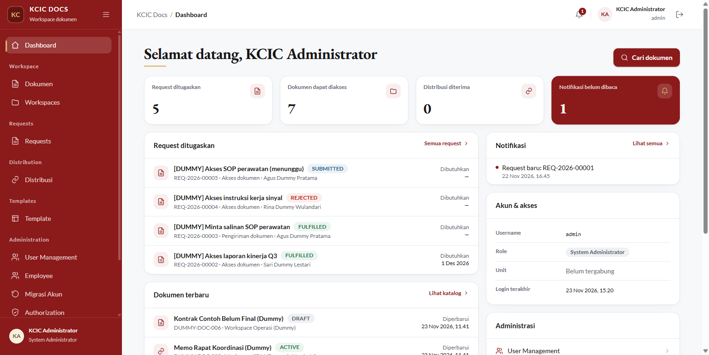
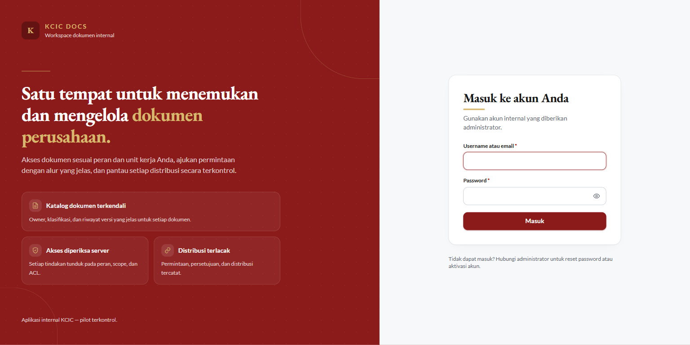

# KCIC Docs

**Workspace dokumen internal PT KCIC** — satu tempat untuk menemukan, mengelola, meminta, dan mendistribusikan dokumen perusahaan secara terkontrol.

KCIC Docs menggantikan kebiasaan mencari dokumen lewat percakapan informal: setiap dokumen punya owner, klasifikasi, dan riwayat versi; setiap akses diperiksa server berdasarkan peran, scope unit kerja, dan ACL; setiap permintaan, persetujuan, dan distribusi tercatat dan dapat diaudit.



## Fitur utama

| Modul | Kemampuan |
|---|---|
| **Katalog dokumen** | Pencarian dan filter server-side (workspace, folder, kategori, jenis, klasifikasi, tag, status), favorit, detail dokumen dengan metadata lengkap dan aktivitas terkini |
| **File & versi** | Upload file private (PDF, Office, TXT, CSV) dengan validasi ekstensi/MIME/magic-byte dan batas ukuran; riwayat versi immutable — revisi membuat versi baru, satu versi current per dokumen; preview dan download hanya setelah otorisasi |
| **Tautan Office/eksternal** | Pencatatan tautan HTTPS (SharePoint, OneDrive, Google Drive, Office) beserta metadata; aplikasi tidak mengubah permission di penyedia eksternal |
| **Workspace & folder** | Ruang kerja per unit/proyek dengan folder berjenjang dan kebijakan akses sendiri |
| **Hak akses** | RBAC + scope (direktorat/departemen/biro, opsional termasuk turunan) + ACL per resource dengan allow/deny eksplisit; backend adalah otoritas akses, bukan menu tersembunyi |
| **Request & approval** | Permintaan akses atau pengiriman dokumen dengan alur submit → review → approve/reject → fulfill (grant akses atau tautan dokumen); histori lengkap dan notifikasi tiap langkah |
| **Distribusi** | Pengiriman dokumen ke akun/unit internal dengan expiry dan kemampuan revoke; kotak masuk "diterima" dan "dikirim" beserta status baca |
| **Template resmi** | Katalog template dengan lifecycle draft → published, versioning, dan pencatatan usage (view/download) |
| **Notifikasi** | In-app notification untuk request, approval, distribusi, dan kejadian penting lain |
| **Audit trail** | Pencatatan aksi bisnis (login, upload, download, approve, distribute, revoke, perubahan administrasi) dengan filter actor/action/outcome/tanggal — akses dibatasi permission `audit.view` |
| **Administrasi** | Manajemen user, employee (NIP, penempatan one-to-one ke akun), organisasi bertipe (Direktorat → Departemen → Biro/Division), master data, role & permission, serta kebijakan file |
| **Profil** | Halaman profil sendiri: data diri, rantai penempatan organisasi, dan ganti password |

## Peran & akses

Role dapat dikonfigurasi administrator (permission per modul). Pola bawaan pilot:

| Peran | Cakupan khas |
|---|---|
| **Employee** | Membaca dokumen sesuai scope unit dan ACL, mengajukan request, menerima distribusi |
| **PIC / Unit Manager** | Approval request dalam scope unitnya (direktorat/departemen/biro, dapat termasuk turunan) |
| **Contributor** | Mengelola dokumen di workspace yang ditugaskan |
| **Document Admin / Admin** | Mengelola katalog, versi, ACL, dan fulfillment dokumen |
| **Administrator / System Admin** | Administrasi user, organisasi, role, dan master data; assignment governance tidak otomatis memberi akses konten |
| **Auditor** | Membaca audit trail |

Semua keputusan akses ditegakkan backend (default deny, scope, ACL, explicit deny, expiry, revoke). UI hanya menyembunyikan menu yang tidak relevan — bukan pengaman.

## Cara menggunakan

1. **Masuk** dengan akun internal dari administrator (tidak ada registrasi mandiri). Akun baru wajib mengganti password temporary pada login pertama.

   

2. **Temukan dokumen** lewat Dashboard (ringkasan request, distribusi, notifikasi, dokumen terbaru) atau menu **Dokumen** — cari judul/kode, filter workspace/kategori/klasifikasi, tandai favorit.
3. **Buka detail dokumen** untuk melihat metadata, owner, klasifikasi, riwayat versi, dan ACL. Preview atau download tersedia bila Anda punya izin; dokumen confidential/restricted mengikuti kebijakan klasifikasi.
4. **Tidak punya akses?** Ajukan **Request** (akses dokumen atau pengiriman dokumen). Request dirutekan ke approver scope unit terkait; Anda mendapat notifikasi saat disetujui/ditolak dan saat dipenuhi.
5. **Approver (PIC/Unit Manager)** membuka menu **Requests**, meninjau, lalu approve/reject dengan catatan; fulfillment meng-grant akses atau menautkan dokumen.
6. **Distribusi**: pemilik dokumen mengirim edaran ke akun/unit dengan tanggal kedaluwarsa; penerima melihatnya di kotak masuk distribusi; pengirim dapat mencabut (revoke) kapan saja.
7. **Template**: ambil template resmi berstatus published; penggunaan (view/download) tercatat untuk governance.
8. **Kontributor/admin dokumen** meng-upload versi baru, mengatur folder/ACL, dan mengarsipkan dokumen bila tidak berlaku lagi (arsip dapat dipulihkan).
9. **Profil** (kanan atas): lihat data diri dan penempatan organisasi, ganti password. Mengganti password otomatis mengakhiri sesi lain milik akun Anda.

Panduan lengkap per peran: [`docs/USER_GUIDE.md`](docs/USER_GUIDE.md) dan [`docs/ADMIN_GUIDE.md`](docs/ADMIN_GUIDE.md).

---

## Untuk developer

Pilot dengan standar engineering produk: modular monolith, migrasi berversi, otorisasi backend-authoritative, storage private, test otomatis, dan quality gate berbasis bukti.

### Stack

| Layer | Teknologi |
|---|---|
| Frontend | React 19 + TypeScript + Vite, Tailwind CSS 4, React Router, TanStack Query |
| Backend | Java 21 target (JDK 23 runtime), Spring Boot 3.5, Spring Security, Spring Session JDBC, Flyway, JPA |
| Database | PostgreSQL 16+ (install native; terverifikasi dengan PostgreSQL 18) |
| Object storage | Adapter filesystem untuk dev lokal; MinIO (bucket private) untuk shared/produksi, diakses hanya oleh backend |
| Test | JUnit 5, MockMvc, Testcontainers (opsional) atau fallback PostgreSQL lokal; Vitest + Testing Library; Playwright E2E (`frontend/e2e`) |

### Struktur repository

```text
backend/                 Spring Boot modular monolith
  src/main/java/com/kcic/connect/{identity,authorization,organization,masterdata,repository,workflow,distribution,template,notification,audit,shared}
  src/main/resources/db/migration/   Migrasi Flyway
frontend/                React SPA
docs/                    Audit, konvensi, keputusan, progres, panduan
docker-compose.yml       Opsional: PostgreSQL + MinIO container (tidak wajib untuk dev lokal)
```

### Prasyarat

- JDK 21+ (terverifikasi dengan JDK 23.0.2)
- Node.js 22.12+ dan npm 10+
- PostgreSQL 16+ native (terverifikasi dengan 18.6 di `127.0.0.1:5432`)
- Apache Maven 3.9+ (environment ini menyediakannya di `tools/apache-maven-3.9.9`; direktori gitignored)
- Docker Desktop — **opsional**, hanya bila memilih PostgreSQL/MinIO container atau Testcontainers

### Setup lokal (PostgreSQL native, tanpa Docker)

1. Buat role dan database sekali, memakai superuser PostgreSQL Anda:

   ```sql
   CREATE ROLE kcic LOGIN PASSWORD '<password lokal pilihan Anda>';
   CREATE DATABASE kcic_connect OWNER kcic;
   ```

   Flyway menerapkan seluruh migrasi otomatis saat backend pertama kali start; jangan mengubah skema manual.

2. Siapkan environment:

   ```bash
   cp .env.example .env                     # isi password lokal; jangan commit .env
   ```

   Default contoh memakai `KCIC_STORAGE_PROVIDER=filesystem` dengan root lokal gitignored, sehingga tidak perlu MinIO untuk development.

3. Jalankan aplikasi:

   ```bash
   # Backend (memuat .env; sintaks Git Bash)
   set -a && source .env && set +a
   tools/apache-maven-3.9.9/bin/mvn -f backend/pom.xml spring-boot:run

   # Frontend (terminal terpisah)
   cd frontend
   npm install
   npm run dev                              # http://localhost:5173, proxy /api ke :8080
   ```

Administrator dibuat **sekali**, hanya saat `identity.users` kosong, dari `KCIC_BOOTSTRAP_ADMIN_*`. Tidak ada password seed di source code. Akun ditandai `must_change_password` dan wajib ganti password setelah login pertama. Set `KCIC_BOOTSTRAP_ADMIN_EMPLOYEE_NIP` setelah `identity.users.employee_id` `NOT NULL` (V18): bootstrap admin ditautkan ke Employee ACTIVE yang sudah ada; NIP tak dikenal/non-ACTIVE membatalkan startup alih-alih membuat akun invalid.

#### Opsional: infrastruktur container

`docker compose up -d` tetap menyediakan PostgreSQL (5433) + MinIO (9000/9001) bila lebih suka container. Arahkan `KCIC_DB_URL` ke port 5433 dan set `KCIC_STORAGE_PROVIDER=minio` dengan kredensial MinIO dari `.env`. Jalur ini bukan default dan tidak dibutuhkan gate mana pun.

### Quality gates

```bash
# Backend — integration test butuh database PostgreSQL.
# Opsi A (tanpa Docker): database test khusus, dibuat sekali:
#   CREATE DATABASE kcic_connect_test OWNER kcic;
KCIC_TEST_DB_URL='jdbc:postgresql://127.0.0.1:5432/kcic_connect_test' \
KCIC_TEST_DB_USERNAME=kcic KCIC_TEST_DB_PASSWORD='<password lokal>' \
tools/apache-maven-3.9.9/bin/mvn -f backend/pom.xml test
# Opsi B: dengan Docker berjalan, hilangkan variabel KCIC_TEST_DB_* dan
# Testcontainers menyediakan PostgreSQL disposable otomatis.
tools/apache-maven-3.9.9/bin/mvn -f backend/pom.xml package

# Frontend
cd frontend
npm run lint
npm run typecheck
npm run test
npm run build

# E2E smoke (butuh backend + database + frontend berjalan; kredensial dari environment)
export KCIC_E2E_BASE_URL=http://localhost:5173
export KCIC_E2E_ADMIN_USERNAME='<username admin>'
export KCIC_E2E_ADMIN_PASSWORD='<password admin>'
export KCIC_E2E_EMPLOYEE_USERNAME='<username employee>'
export KCIC_E2E_EMPLOYEE_PASSWORD='<password employee>'
npm run test:e2e --prefix frontend
```

Suite E2E gagal cepat dengan pesan jelas bila kredensial `KCIC_E2E_*` tidak ada; password tidak pernah di-commit. Cakupannya: redirect unauthenticated, login invalid, navigasi employee/halaman forbidden, deep link admin, filter audit, dan route not-found. Bukti acceptance journey lengkap tercatat di `docs/UAT.md`.

Integration/security test memakai database test khusus — bukan database development. Tanpa `KCIC_TEST_DB_URL` mereka fallback ke Testcontainers dan butuh Docker; bila keduanya tidak tersedia, test gagal dengan error environment eksplisit (terdokumentasi, tidak pernah di-skip diam-diam). Test idempotent (username unik per run), sehingga re-run terhadap database test lokal persisten aman.

### Konfigurasi

Seluruh konfigurasi berbasis environment (`backend/src/main/resources/application.yml`). Secret tidak pernah di-commit. Lihat `.env.example` untuk daftar lengkap dan `docs/DEPLOYMENT.md` untuk kebutuhan produksi (TLS, secure cookie, bucket private, backup).

### Dokumentasi

- `AGENTS.md`, `PRD.md`, `ARCHITECTURE.md`, `SCHEMA.md`, `DESIGN_SYSTEM.md`, `IMPLEMENTATION_PLAN.md` — dokumen governing
- `docs/PHASE-0-AUDIT.md` — audit environment dan repository
- `docs/API_CONVENTIONS.md` — aturan kontrak API
- `docs/MIGRATION_CONVENTIONS.md` — aturan perubahan skema
- `docs/MIGRATION_PLAN.md` — cutover dan rollback organisasi/identity seri-E
- `docs/organization-identity/` — audit E0, gap analysis, risk register migrasi
- `docs/DECISIONS.md` — keputusan engineering dan override
- `docs/PROGRESS.md` — status story/fase dengan bukti
- `docs/SECURITY.md` — model keamanan dan residual risk
- `docs/UAT.md`, `docs/DEPLOYMENT.md`, `docs/USER_GUIDE.md`, `docs/ADMIN_GUIDE.md` — handover operasional

### Batasan pilot

Ditunda oleh keputusan produk: SSO/OIDC/LDAP/HRIS, Microsoft Graph/SharePoint/OneDrive API dan sinkronisasi permission, antivirus/malware scanning, centralized logging/APM, Redis, message broker, Kubernetes, microservices, email/WhatsApp/SMS/push, guest/public sharing, OCR/pencarian isi dokumen full-text, collaborative editing.

Ditunda **bukan** berarti kontrol dasar hilang: validasi input/file, storage private, log aman, audit trail, error handling, otorisasi, test, dan backup/restore tetap dalam scope.