# KCIC Docs — Database Schema Specification

| Metadata | Nilai |
|---|---|
| Product | KCIC Docs |
| Document | Database Schema & Data Model |
| Version | 1.0 |
| Status | Baseline schema untuk migration dan technical implementation |
| Tanggal | 22 November 2026 |
| Database | PostgreSQL |
| Referensi | `PRD.md`, `ARCHITECTURE.md` |

---

## 1. Tujuan dan Prinsip Data

Dokumen ini menetapkan model data relasional KCIC Docs sebagai acuan migration, entity mapping, repository, API, dan test.

Prinsip:

1. PostgreSQL adalah source of truth untuk akun lokal, organisasi, authorization, master data, metadata dokumen, workflow, distribution, template, notification, dan audit.
2. Binary file disimpan pada private MinIO/S3-compatible object storage, bukan di kolom PostgreSQL.
3. Identitas dokumen terpisah dari versi dokumen.
4. Request, distribution, dan template mempunyai lifecycle masing-masing tetapi menggunakan document/version yang sama.
5. Relasi penting dijaga dengan FK, unique constraint, check constraint, dan transaction; bukan hanya validasi aplikasi.
6. Record yang memiliki histori tidak dihapus permanen melalui UI normal.
7. Semua timestamp menggunakan `TIMESTAMPTZ` dan disimpan sebagai UTC.
8. UUID digunakan untuk primary key resource.
9. Nama schema/table/column menggunakan `snake_case`; nama domain/kode di API tetap mengikuti contract API.
10. Migration bersifat versioned dan menjadi satu-satunya jalur perubahan schema.

### 1.1 Notasi

- **PK**: primary key.
- **FK**: foreign key.
- **UQ**: unique constraint/index.
- **NN**: NOT NULL.
- **JSONB**: data tambahan yang tidak menjadi pengganti relasi/kolom inti.
- `created_at`, `updated_at`: `TIMESTAMPTZ NOT NULL` pada tabel mutable.
- `created_by`, `updated_by`: nullable/required sesuai kebutuhan bootstrap dan foreign key ke `identity.users(id)`.

---

## 2. PostgreSQL Schema Namespaces

Gunakan schema PostgreSQL berdasarkan domain untuk menguatkan ownership tanpa menjadikan setiap schema sebagai microservice.

| PostgreSQL schema | Ownership | Tabel utama |
|---|---|---|
| `identity` | Local account | `users` |
| `organization` | Struktur organisasi | `organization_units`, `user_organization_assignments` |
| `authorization` | RBAC, scope, ACL | `roles`, `permissions`, `role_permissions`, `user_role_assignments`, `resource_permissions` |
| `master` | Master data dokumen | `document_categories`, `document_types`, `document_classifications`, `tags`, `file_policies` |
| `repository` | Document catalog dan content metadata | `workspaces`, `folders`, `documents`, `document_owner_history`, `document_versions`, `storage_objects`, `external_resources`, `document_tag_assignments`, `document_favorites` |
| `workflow` | Request dan fulfillment | `document_requests`, `request_attachments`, `request_approvals`, `request_fulfillments`, `request_fulfillment_items`, `request_histories` |
| `distribution` | Internal distribution | `distributions`, `distribution_items`, `distribution_recipients`, `distribution_access_grants`, `distribution_events` |
| `template` | Template catalog | `document_templates`, `template_usage_events` |
| `notification` | In-app notification | `notifications` |
| `audit` | Business audit | `audit_events` |

### 2.1 Pembuatan schema dan UUID

```sql
CREATE SCHEMA IF NOT EXISTS identity;
CREATE SCHEMA IF NOT EXISTS organization;
CREATE SCHEMA IF NOT EXISTS authorization;
CREATE SCHEMA IF NOT EXISTS master;
CREATE SCHEMA IF NOT EXISTS repository;
CREATE SCHEMA IF NOT EXISTS workflow;
CREATE SCHEMA IF NOT EXISTS distribution;
CREATE SCHEMA IF NOT EXISTS template;
CREATE SCHEMA IF NOT EXISTS notification;
CREATE SCHEMA IF NOT EXISTS audit;

-- PostgreSQL modern versions provide gen_random_uuid().
-- Confirm the minimum PostgreSQL version during environment setup.
```

---

## 3. Entity Relationship Overview

```mermaid
erDiagram
    USERS ||--o{ USER_ORGANIZATION_ASSIGNMENTS : assigned_to
    ORGANIZATION_UNITS ||--o{ USER_ORGANIZATION_ASSIGNMENTS : has_members
    ORGANIZATION_UNITS ||--o{ ORGANIZATION_UNITS : parent_of

    USERS ||--o{ USER_ROLE_ASSIGNMENTS : receives
    ROLES ||--o{ USER_ROLE_ASSIGNMENTS : assigned
    ROLES ||--o{ ROLE_PERMISSIONS : contains
    PERMISSIONS ||--o{ ROLE_PERMISSIONS : mapped
    RESOURCE_PERMISSIONS }o--|| PERMISSIONS : grants

    ORGANIZATION_UNITS ||--o{ WORKSPACES : owns
    WORKSPACES ||--o{ FOLDERS : contains
    FOLDERS ||--o{ FOLDERS : parent_of
    WORKSPACES ||--o{ DOCUMENTS : contains
    DOCUMENTS ||--o{ DOCUMENT_OWNER_HISTORY : ownership_history
    DOCUMENTS ||--o{ DOCUMENT_VERSIONS : has_versions
    DOCUMENT_VERSIONS }o--o| STORAGE_OBJECTS : stores
    DOCUMENT_VERSIONS }o--o| EXTERNAL_RESOURCES : references
    DOCUMENTS ||--o{ DOCUMENT_TAG_ASSIGNMENTS : tagged
    TAGS ||--o{ DOCUMENT_TAG_ASSIGNMENTS : labels
    USERS ||--o{ DOCUMENT_FAVORITES : favorites
    DOCUMENTS ||--o{ DOCUMENT_FAVORITES : saved_by

    USERS ||--o{ DOCUMENT_REQUESTS : requests
    DOCUMENT_REQUESTS ||--o{ REQUEST_ATTACHMENTS : has_files
    DOCUMENT_REQUESTS ||--o{ REQUEST_APPROVALS : reviewed
    DOCUMENT_REQUESTS ||--o{ REQUEST_FULFILLMENTS : fulfilled
    DOCUMENT_REQUESTS ||--o{ REQUEST_HISTORIES : history
    REQUEST_FULFILLMENTS ||--o{ REQUEST_FULFILLMENT_ITEMS : contains

    USERS ||--o{ DISTRIBUTIONS : sends
    DISTRIBUTIONS ||--o{ DISTRIBUTION_ITEMS : includes
    DISTRIBUTIONS ||--o{ DISTRIBUTION_RECIPIENTS : sent_to
    DISTRIBUTION_RECIPIENTS ||--o{ DISTRIBUTION_ACCESS_GRANTS : creates
    DISTRIBUTION_ITEMS ||--o{ DISTRIBUTION_ACCESS_GRANTS : applies_to

    DOCUMENTS ||--o| DOCUMENT_TEMPLATES : template_metadata
    USERS ||--o{ NOTIFICATIONS : receives
    USERS ||--o{ AUDIT_EVENTS : acts
```



Diagram di atas menunjukkan hubungan domain utama; detail kolom, aturan, dan constraint berada pada bagian berikutnya.

---

## 4. Identity Domain — `identity`

### 4.1 `identity.users`

| Kolom | Tipe | Aturan / keterangan |
|---|---|---|
| `id` | UUID | PK, internal stable user identifier |
| `username` | VARCHAR(100) | NN; display/login identifier |
| `email` | VARCHAR(254) | Nullable sesuai policy perusahaan |
| `display_name` | VARCHAR(160) | NN |
| `password_hash` | VARCHAR(255) | NN; adaptive one-way hash, tidak pernah dikirim ke client |
| `account_status` | VARCHAR(20) | NN; `ACTIVE`, `INACTIVE`, `LOCKED` |
| `must_change_password` | BOOLEAN | NN, default false |
| `failed_login_count` | INTEGER | NN, default 0 |
| `locked_until` | TIMESTAMPTZ | Nullable |
| `password_changed_at` | TIMESTAMPTZ | Nullable sampai credential awal ditetapkan |
| `last_login_at` | TIMESTAMPTZ | Nullable |
| `deactivated_at` | TIMESTAMPTZ | Nullable |
| `created_at`, `updated_at` | TIMESTAMPTZ | NN |
| `created_by`, `updated_by` | UUID | FK ke `identity.users.id`, nullable untuk bootstrap awal |
| `row_version` | BIGINT | NN, default 0; optimistic locking |

**Constraint dan index:**

- Unique username case-insensitive melalui unique index `LOWER(username)`.
- Unique email case-insensitive untuk email yang tidak null melalui partial unique index.
- Check account status dan `failed_login_count >= 0`.
- Index `(account_status)` dan `(last_login_at)` bila diperlukan admin listing.
- Password reset dilakukan oleh admin dengan mekanisme aman/forced change; password atau temporary password tidak disimpan ke audit event.
- Username/email tidak boleh menjadi foreign key domain lain; relasi selalu memakai `users.id`.
- **E-series (planned, V16+):** tambah `employee_id UUID UNIQUE NULL` FK ke `identity.employees`; `display_name` dan `email` menjadi deprecated setelah backfill dan tidak ditulis lagi. Lihat §21.

### 4.2 Session persistence

Session dikelola oleh Spring Security. Jika Spring Session JDBC digunakan, tabel teknis session mengikuti DDL resmi versi dependency yang dipilih dan ditempatkan di schema yang disepakati. Tabel session bukan bagian domain produk dan tidak boleh dipakai sebagai pengganti `users` atau audit.

Tidak ada tabel identity provider/SSO pada pilot.

---

## 5. Organization Domain — `organization`

### 5.1 `organization.organization_units`

| Kolom | Tipe | Aturan / keterangan |
|---|---|---|
| `id` | UUID | PK |
| `parent_id` | UUID | Nullable FK self-reference |
| `unit_code` | VARCHAR(50) | NN, unique case-insensitive |
| `unit_name` | VARCHAR(160) | NN |
| `description` | TEXT | Nullable |
| `unit_status` | VARCHAR(20) | NN; `ACTIVE`, `INACTIVE` |
| `created_at`, `updated_at` | TIMESTAMPTZ | NN |
| `created_by`, `updated_by` | UUID | FK users |
| `row_version` | BIGINT | NN, default 0 |

Aturan: parent tidak boleh sama dengan ID sendiri; aplikasi harus mencegah circular hierarchy. Unit yang direferensikan user/workspace tidak boleh hard-delete melalui UI.

### 5.2 `organization.user_organization_assignments`

| Kolom | Tipe | Aturan / keterangan |
|---|---|---|
| `id` | UUID | PK |
| `user_id` | UUID | NN FK users |
| `organization_unit_id` | UUID | NN FK organization_units |
| `assignment_type` | VARCHAR(20) | NN; `PRIMARY`, `SECONDARY` |
| `valid_from` | TIMESTAMPTZ | NN |
| `valid_until` | TIMESTAMPTZ | Nullable; harus lebih besar dari valid_from |
| `is_active` | BOOLEAN | NN, default true |
| `assigned_by` | UUID | NN FK users |
| `created_at` | TIMESTAMPTZ | NN |

Aturan: satu primary assignment aktif per user pada satu waktu; masa assignment yang overlapping perlu divalidasi service/database sesuai policy. Assignment lama dipertahankan sebagai histori.

---

## 6. Authorization Domain — `authorization`

### 6.1 `authorization.roles`

Kolom: `id UUID PK`, `role_code VARCHAR(80) UNIQUE NOT NULL`, `role_name VARCHAR(120) NOT NULL`, `description TEXT`, `is_system_role BOOLEAN NOT NULL DEFAULT false`, `role_status VARCHAR(20) NOT NULL CHECK (role_status IN ('ACTIVE','INACTIVE'))`, timestamps, actor references, `row_version`.

Seed baseline role:

- `SYSTEM_ADMIN`
- `DOCUMENT_ADMIN`
- `UNIT_MANAGER`
- `CONTRIBUTOR`
- `EMPLOYEE`
- `AUDITOR`

Seed role bukan berarti seluruh user mendapat role tersebut. Assignment harus dibuat eksplisit dengan scope.

Model role pilot (V19, keputusan pemilik produk 2026-11-23) menambahkan tiga role sistem
tanpa menghapus baseline, sehingga assignment dan audit lama tetap valid:

| Role | Cakupan |
|---|---|
| `ADMINISTRATOR` | Tata kelola penuh (governance) setara `SYSTEM_ADMIN`: akun, role, organisasi, master data, audit, operasional konten. Akses konten tetap tunduk pada ACL/ownership. |
| `ADMIN` | Operasional dokumen dan workflow: repository, template, request (approve/fulfill), distribusi, audit. Tanpa `user.manage`, `role.manage`, `organization.manage`, `master_data.manage`, `employee.manage`. |
| `PIC` | Penanggung jawab unit: kelola dokumen dan request dalam scope unit, distribusi, template. Tanpa governance dan tanpa `document.manage_access`/`archive`/`restore`. |
| `EMPLOYEE` | Ditampilkan sebagai **User (Employee)**; permission baseline tidak berubah. |

Routing request: approver unit diprioritaskan `UNIT_MANAGER` lalu `PIC`; administrator dokumen
`DOCUMENT_ADMIN` lalu `ADMIN`; fallback governance `SYSTEM_ADMIN` lalu `ADMINISTRATOR`.

### 6.2 `authorization.permissions`

Kolom: `id UUID PK`, `permission_code VARCHAR(120) UNIQUE NOT NULL`, `permission_name VARCHAR(160) NOT NULL`, `description TEXT`, `module_code VARCHAR(60) NOT NULL`, `created_at TIMESTAMPTZ NOT NULL`.

Contoh permission baseline (final catalog mengikuti PRD dan API implementation):

```text
user.manage
role.manage
master_data.manage
workspace.view
workspace.manage
folder.view
folder.create
folder.update
folder.archive
document.view
document.preview
document.download
document.create
document.upload
document.update_metadata
document.create_version
document.archive
document.restore
document.share
document.manage_access
request.create
request.view_own
request.view_assigned
request.approve
request.reject
request.fulfill
distribution.create
distribution.view_own
distribution.view_received
distribution.revoke
template.view
template.create
template.publish
template.archive
notification.view
notification.manage
audit.view
```

### 6.3 `authorization.role_permissions`

Kolom: `role_id UUID FK roles`, `permission_id UUID FK permissions`, `created_at TIMESTAMPTZ`; PK gabungan `(role_id, permission_id)`. Delete role/permission yang sudah direferensikan harus dibatasi; gunakan deactivation atau migration.

### 6.4 `authorization.user_role_assignments`

| Kolom | Tipe | Aturan / keterangan |
|---|---|---|
| `id` | UUID | PK |
| `user_id` | UUID | NN FK users |
| `role_id` | UUID | NN FK roles |
| `scope_type` | VARCHAR(30) | NN; `GLOBAL`, `ORGANIZATION_UNIT`, `WORKSPACE` |
| `organization_unit_id` | UUID | FK unit; terisi hanya untuk scope unit |
| `workspace_id` | UUID | FK workspace; terisi hanya untuk scope workspace |
| `valid_from` | TIMESTAMPTZ | NN |
| `valid_until` | TIMESTAMPTZ | Nullable |
| `assignment_status` | VARCHAR(20) | NN; `ACTIVE`, `REVOKED`, `EXPIRED` |
| `assigned_by` | UUID | NN FK users |
| `revoked_by` | UUID | Nullable FK users |
| `revoked_at` | TIMESTAMPTZ | Nullable |
| `created_at` | TIMESTAMPTZ | NN |

Check constraint memastikan scope GLOBAL tidak memiliki `organization_unit_id`/`workspace_id`; scope ORGANIZATION_UNIT harus memiliki hanya `organization_unit_id`; scope WORKSPACE harus memiliki hanya `workspace_id`. FK workspace ditambahkan setelah tabel repository dibuat atau dibuat pada migration dependency yang tepat.

### 6.5 `authorization.resource_permissions`

| Kolom | Tipe | Aturan / keterangan |
|---|---|---|
| `id` | UUID | PK |
| `resource_type` | VARCHAR(20) | NN; `WORKSPACE`, `FOLDER`, `DOCUMENT` |
| `resource_id` | UUID | NN; target resource ID, tervalidasi oleh authorization/repository service |
| `principal_type` | VARCHAR(30) | NN; `USER`, `ROLE`, `ORGANIZATION_UNIT` |
| `principal_user_id` | UUID | Nullable FK users |
| `principal_role_id` | UUID | Nullable FK roles |
| `principal_organization_unit_id` | UUID | Nullable FK organization_units |
| `permission_id` | UUID | NN FK permissions |
| `effect` | VARCHAR(10) | NN; `ALLOW`, `DENY` |
| `granted_by` | UUID | NN FK users |
| `grant_source` | VARCHAR(20) | NN; `MANUAL`, `REQUEST`, `DISTRIBUTION`, `SYSTEM` |
| `granted_at` | TIMESTAMPTZ | NN |
| `expires_at` | TIMESTAMPTZ | Nullable |
| `revoked_by` | UUID | Nullable FK users |
| `revoked_at` | TIMESTAMPTZ | Nullable |
| `created_at` | TIMESTAMPTZ | NN |

Check constraint memastikan tepat satu kolom principal terisi sesuai `principal_type`. `resource_id` bersifat polymorphic; FK spesifik tidak dapat didefinisikan sebagai satu FK biasa. Validasi target resource dilakukan pada use case dan diuji dengan integration test. Jika dibutuhkan enforcement DB lebih kuat, gunakan tabel ACL per resource type, bukan trigger polymorphic yang tersembunyi.

**Permission semantics:** `DENY` mengalahkan inherited `ALLOW`; grant yang expired/revoked tidak berlaku. Role capability tetap menjadi syarat dan tidak dapat dilewati ACL.

---

## 7. Master Data Domain — `master`

### 7.1 `master.document_categories`

Kolom: `id UUID PK`, `parent_id UUID NULL FK self`, `category_code VARCHAR(60) UNIQUE NOT NULL`, `category_name VARCHAR(140) NOT NULL`, `description TEXT`, `is_active BOOLEAN NOT NULL DEFAULT true`, timestamps, `row_version`.

### 7.2 `master.document_types`

Kolom: `id UUID PK`, `type_code VARCHAR(60) UNIQUE NOT NULL`, `type_name VARCHAR(140) NOT NULL`, `description TEXT`, `is_active BOOLEAN NOT NULL DEFAULT true`, timestamps, `row_version`.

Contoh seed: SOP, Work Instruction, Report, Memo, Form, Contract/Agreement, Minutes of Meeting, Technical Document. Daftar final ditetapkan business owner.

### 7.3 `master.document_classifications`

Kolom: `id UUID PK`, `classification_code VARCHAR(40) UNIQUE NOT NULL`, `classification_name VARCHAR(100) NOT NULL`, `sensitivity_rank SMALLINT NOT NULL`, `description TEXT`, `is_active BOOLEAN NOT NULL DEFAULT true`, timestamps.

Baseline PRD: `INTERNAL`, `CONFIDENTIAL`, `RESTRICTED`. Urutan sensitivity dan aturan akses harus disetujui pemilik kebijakan perusahaan; jangan mengarang mapping final.

### 7.4 `master.tags`

Kolom: `id UUID PK`, `tag_code VARCHAR(60) UNIQUE NOT NULL`, `tag_name VARCHAR(100) NOT NULL`, `is_active BOOLEAN NOT NULL DEFAULT true`, `created_at`, `updated_at`.

### 7.5 `master.file_policies`

Kolom: `id UUID PK`, `policy_code VARCHAR(60) UNIQUE NOT NULL`, `policy_name VARCHAR(120) NOT NULL`, `allowed_extensions TEXT[] NOT NULL`, `allowed_mime_types TEXT[] NOT NULL`, `max_file_size_bytes BIGINT NOT NULL CHECK (max_file_size_bytes > 0)`, `is_default BOOLEAN NOT NULL DEFAULT false`, `is_active BOOLEAN NOT NULL DEFAULT true`, timestamps, `updated_by UUID FK users`.

Gunakan allowlist dan validasi backend. Nilai format dan batas maksimum final merupakan open decision sebelum operasional. MIME/extension bukan bukti antivirus.

### 7.6 `master.positions` (V20)

Kolom: `id UUID PK`, `position_code VARCHAR(40) NOT NULL`, `position_name VARCHAR(140) NOT NULL`, `description VARCHAR(4000)`, `is_active BOOLEAN NOT NULL DEFAULT true`, `created_at`/`updated_at TIMESTAMPTZ`, `created_by`/`updated_by UUID FK users`, `row_version BIGINT NN default 0`.

- Unique index case-insensitive `positions_code_lower_uq (LOWER(position_code))`; index `positions_active_idx (is_active)`.
- Katalog jabatan adalah atribut kepegawaian, bukan tingkat unit organisasi (hierarki tetap COMPANY→DIRECTORATE→DEPARTMENT→DIVISION).
- Seed idempotent V20: DIREKTUR, KEPALA_DEPARTEMEN, KEPALA_BIRO, MANAGER, SUPERVISOR, STAFF.
- Assignment baru menuntut posisi ACTIVE; employee yang sudah memakai posisi yang dinonaktifkan tetap boleh mempertahankannya; clear (NULL) selalu diizinkan.

---

## 8. Repository Domain — `repository`

### 8.1 `repository.workspaces`

Kolom utama:

- `id UUID PK`
- `workspace_code VARCHAR(80) UNIQUE NOT NULL`
- `workspace_name VARCHAR(160) NOT NULL`
- `description TEXT`
- `owner_organization_unit_id UUID NOT NULL FK organization_units`
- `owner_user_id UUID NULL FK users`
- `workspace_status VARCHAR(20) NOT NULL CHECK (workspace_status IN ('ACTIVE','ARCHIVED','INACTIVE'))`
- `created_at`, `updated_at`, `created_by`, `updated_by`, `row_version`

Workspace menjadi salah satu scope authorization. Pemilik workspace tidak otomatis memberikan akses global kepada seluruh anggota unit; policy tetap dievaluasi.

### 8.2 `repository.folders`

Kolom: `id UUID PK`, `workspace_id UUID NOT NULL FK workspaces`, `parent_folder_id UUID NULL`, `folder_name VARCHAR(160) NOT NULL`, `description TEXT`, `folder_status VARCHAR(20) NOT NULL CHECK (folder_status IN ('ACTIVE','ARCHIVED'))`, timestamps, actor references, `row_version`.

Gunakan `UNIQUE (id, workspace_id)` dan composite FK `(parent_folder_id, workspace_id) REFERENCES repository.folders(id, workspace_id)` untuk mencegah parent berasal dari workspace lain. Aplikasi mencegah circular parent chain. Unique folder name perlu mempertimbangkan root vs child; implementasikan unique index terpisah untuk root dan sibling folders sesuai kebutuhan.

### 8.3 `repository.documents`

| Kolom | Tipe | Aturan / keterangan |
|---|---|---|
| `id` | UUID | PK |
| `document_code` | VARCHAR(100) | Nullable/conditional; unique jika diwajibkan policy |
| `title` | VARCHAR(240) | NN |
| `description` | TEXT | Nullable |
| `workspace_id` | UUID | NN FK workspaces |
| `folder_id` | UUID | Nullable; harus berada pada workspace yang sama |
| `category_id` | UUID | NN FK document_categories |
| `document_type_id` | UUID | NN FK document_types |
| `classification_id` | UUID | NN FK document_classifications |
| `owner_user_id` | UUID | Nullable FK users |
| `owner_organization_unit_id` | UUID | Nullable FK organization_units |
| `document_status` | VARCHAR(20) | NN; `DRAFT`, `ACTIVE`, `ARCHIVED` |
| `effective_date` | DATE | Nullable |
| `review_date` | DATE | Nullable |
| `expiry_date` | DATE | Nullable; bukan auto-delete |
| `created_by`, `updated_by` | UUID | FK users |
| `created_at`, `updated_at` | TIMESTAMPTZ | NN |
| `row_version` | BIGINT | NN, default 0 |

Check: tepat satu owner type terisi (`owner_user_id` XOR `owner_organization_unit_id`) pada baseline. Bila bisnis kemudian memerlukan co-owner, model harus diperluas dengan tabel owner assignments, bukan menambah banyak kolom owner.

Composite FK `(folder_id, workspace_id)` ke `folders(id, workspace_id)` menjaga folder berada pada workspace yang sama. `document_code` unique case-insensitive bila nilainya tidak null dan policy mewajibkan keunikan global. Bila code hanya unik per workspace/category, ubah unique key melalui keputusan business rule.

### 8.4 `repository.document_owner_history`

| Kolom | Tipe | Aturan / keterangan |
|---|---|---|
| `id` | UUID | PK |
| `document_id` | UUID | NN FK documents |
| `owner_user_id` | UUID | Nullable FK users |
| `owner_organization_unit_id` | UUID | Nullable FK organization_units |
| `valid_from` | TIMESTAMPTZ | NN |
| `valid_until` | TIMESTAMPTZ | Nullable; null untuk owner saat ini |
| `changed_by` | UUID | NN FK users |
| `change_reason` | TEXT | Nullable/required sesuai policy |
| `created_at` | TIMESTAMPTZ | NN |

Check tepat satu owner type terisi. Saat owner berubah, tutup row sebelumnya (`valid_until`) dan insert row baru dalam transaction yang sama dengan update `documents.owner_*`. Tidak boleh ada dua owner-history row aktif untuk document yang sama. Perubahan dicatat pula pada audit trail. Pada pembuatan dokumen, insert initial owner-history row.

### 8.5 `repository.storage_objects`

Kolom: `id UUID PK`, `storage_provider VARCHAR(30) NOT NULL`, `bucket_name VARCHAR(120) NOT NULL`, `object_key VARCHAR(700) NOT NULL`, `original_filename VARCHAR(255) NOT NULL`, `content_type VARCHAR(160) NOT NULL`, `size_bytes BIGINT NOT NULL CHECK (size_bytes >= 0)`, `checksum_sha256 CHAR(64) NOT NULL`, `upload_status VARCHAR(20) NOT NULL CHECK (upload_status IN ('PENDING','AVAILABLE','DELETE_PENDING','DELETED','FAILED'))`, `uploaded_by UUID NOT NULL FK users`, `uploaded_at TIMESTAMPTZ`, `created_at TIMESTAMPTZ NOT NULL`.

Constraint unique `(storage_provider, bucket_name, object_key)`. `object_key` dibuat server-side dan tidak memakai original filename. `storage_provider` mengidentifikasi adapter/provider, bukan credential.

### 8.6 `repository.external_resources`

Kolom: `id UUID PK`, `url TEXT NOT NULL`, `normalized_host VARCHAR(255) NOT NULL`, `provider_code VARCHAR(40)`, `link_title VARCHAR(240)`, `created_by UUID NOT NULL FK users`, `created_at TIMESTAMPTZ NOT NULL`.

Validasi URL HTTPS dilakukan backend. Jangan menyimpan credential/query token sensitif pada URL. Bila provider URL mengandung token/signature, tolak atau sanitasi sesuai policy; jangan mencatat URL sensitif ke log/audit.

### 8.7 `repository.document_versions`

| Kolom | Tipe | Aturan / keterangan |
|---|---|---|
| `id` | UUID | PK |
| `document_id` | UUID | NN FK documents |
| `version_number` | INTEGER | NN, mulai dari 1 |
| `version_label` | VARCHAR(60) | Nullable |
| `content_source` | VARCHAR(20) | NN; `STORAGE_OBJECT`, `EXTERNAL_LINK` |
| `storage_object_id` | UUID | Nullable FK storage_objects |
| `external_resource_id` | UUID | Nullable FK external_resources |
| `version_status` | VARCHAR(20) | NN; `DRAFT`, `CURRENT`, `SUPERSEDED`, `WITHDRAWN` |
| `change_summary` | TEXT | Nullable |
| `created_by` | UUID | NN FK users |
| `created_at` | TIMESTAMPTZ | NN |
| `published_at` | TIMESTAMPTZ | Nullable |

Check: jika content source `STORAGE_OBJECT`, hanya `storage_object_id` terisi; jika `EXTERNAL_LINK`, hanya `external_resource_id` terisi. Unique `(document_id, version_number)`. Partial unique index pada `document_id WHERE version_status = 'CURRENT'` menjamin maksimal satu current version.

Version lama tidak boleh diubah binary atau ditimpa. Perubahan status version hanya melalui use case terotorisasi dan dicatat audit.

### 8.8 `repository.document_tag_assignments`

Kolom: `document_id UUID FK documents`, `tag_id UUID FK tags`, `assigned_by UUID FK users`, `created_at TIMESTAMPTZ`; PK `(document_id, tag_id)`.

### 8.9 `repository.document_favorites`

Kolom: `user_id UUID NOT NULL FK identity.users`, `document_id UUID NOT NULL FK repository.documents`, `created_at TIMESTAMPTZ NOT NULL`; PK gabungan `(user_id, document_id)`.

Favorite adalah shortcut personal, bukan permission grant. Saat membaca Favorites, backend tetap mengevaluasi akses dokumen dan tidak menampilkan record yang tidak lagi dapat diakses. Index tambahan `(user_id, created_at DESC)` untuk daftar Favorites.

Recent documents dihitung dari event akses yang relevan pada `audit.audit_events` (misalnya document viewed/previewed/downloaded) dan wajib difilter berdasarkan permission saat query dilakukan. Recent activity tidak menjadi sumber authorization.

---

## 9. Workflow Domain — `workflow`

### 9.1 `workflow.document_requests`

| Kolom | Tipe | Aturan / keterangan |
|---|---|---|
| `id` | UUID | PK |
| `request_code` | VARCHAR(50) | NN, unique; human-readable reference |
| `request_type` | VARCHAR(30) | NN; `ACCESS`, `DOCUMENT_DELIVERY`, `TEMPLATE` |
| `requester_user_id` | UUID | NN FK users |
| `title` | VARCHAR(200) | NN |
| `description` | TEXT | Nullable |
| `reason` | TEXT | NN; business purpose |
| `target_document_id` | UUID | Nullable FK documents; wajib untuk ACCESS |
| `target_owner_user_id` | UUID | Nullable FK users |
| `target_organization_unit_id` | UUID | Nullable FK organization_units |
| `assigned_to_user_id` | UUID | Nullable FK users |
| `needed_by_date` | DATE | Nullable |
| `request_status` | VARCHAR(30) | NN; status PRD |
| `submitted_at` | TIMESTAMPTZ | Nullable |
| `closed_at` | TIMESTAMPTZ | Nullable |
| `created_at`, `updated_at` | TIMESTAMPTZ | NN |
| `row_version` | BIGINT | NN, default 0 |

Status: `DRAFT`, `SUBMITTED`, `UNDER_REVIEW`, `APPROVED`, `REJECTED`, `IN_PROGRESS`, `FULFILLED`, `CLOSED`, `CANCELLED`.

Check constraint: `ACCESS` wajib memiliki `target_document_id`. Service harus memastikan target owner/approver sesuai document owner, organization scope, dan assignment policy.

### 9.2 `workflow.request_attachments`

Kolom: `id UUID PK`, `request_id UUID NOT NULL FK document_requests`, `storage_object_id UUID NOT NULL FK repository.storage_objects`, `uploaded_by UUID NOT NULL FK identity.users`, `attached_at TIMESTAMPTZ NOT NULL`, `attachment_status VARCHAR(20) NOT NULL CHECK (attachment_status IN ('ACTIVE','REMOVED'))`.

Lampiran bersifat opsional dan mengikuti file policy yang sama. Binary tetap berada di private object storage. Akses attachment hanya boleh melalui request authorization; lampiran tidak otomatis menjadi document repository item atau grant akses baru. Bila lampiran tidak dibutuhkan pada pilot pertama, implementasinya dapat ditunda tanpa mengubah model request inti.

### 9.3 `workflow.request_approvals`

Kolom: `id UUID PK`, `request_id UUID NOT NULL FK document_requests`, `approver_user_id UUID NOT NULL FK users`, `decision VARCHAR(20) NOT NULL` (`PENDING`,`APPROVED`,`REJECTED`,`CANCELLED`), `decision_reason TEXT`, `assigned_at TIMESTAMPTZ NOT NULL`, `decided_at TIMESTAMPTZ`, `created_at TIMESTAMPTZ NOT NULL`.

Baseline pilot cukup mendukung approval assignment eksplisit/basic. Jangan membuat multi-level workflow engine generik. Bila ada beberapa approver, rule urutan dan quorum harus disepakati sebelum menambah implementasi.

### 9.4 `workflow.request_fulfillments`

Kolom: `id UUID PK`, `request_id UUID NOT NULL FK document_requests`, `fulfillment_type VARCHAR(30) NOT NULL` (`ACCESS_GRANTED`,`DOCUMENT_LINKED`,`DOCUMENT_UPLOADED`,`EXTERNAL_LINK_REGISTERED`), `fulfilled_by_user_id UUID NOT NULL FK users`, `fulfillment_note TEXT`, `fulfilled_at TIMESTAMPTZ NOT NULL`, `created_at TIMESTAMPTZ NOT NULL`.

### 9.5 `workflow.request_fulfillment_items`

Kolom: `id UUID PK`, `fulfillment_id UUID NOT NULL FK request_fulfillments`, `document_id UUID NOT NULL FK documents`, `document_version_id UUID NULL FK document_versions`, `created_at TIMESTAMPTZ NOT NULL`.

Untuk akses, grant yang diberikan dicatat pada `authorization.resource_permissions` dan dihubungkan ke audit/history. Jika request fulfilment memberi access ke document, record grant harus berhasil sebelum request menjadi `FULFILLED`.

### 9.6 `workflow.request_histories`

Kolom: `id UUID PK`, `request_id UUID NOT NULL FK document_requests`, `actor_user_id UUID NULL FK users`, `from_status VARCHAR(30)`, `to_status VARCHAR(30) NOT NULL`, `comment TEXT`, `metadata JSONB`, `occurred_at TIMESTAMPTZ NOT NULL`.

Histori ditulis setiap transisi status/aksi penting; metadata tidak boleh berisi credential, token, signed URL, atau isi dokumen.

---

## 10. Distribution Domain — `distribution`

### 10.1 `distribution.distributions`

Kolom: `id UUID PK`, `distribution_code VARCHAR(50) NOT NULL UNIQUE`, `sender_user_id UUID NOT NULL FK users`, `title VARCHAR(200) NOT NULL`, `message TEXT`, `distribution_status VARCHAR(30) NOT NULL` (`DRAFT`,`SENT`,`PARTIALLY_REVOKED`,`REVOKED`,`EXPIRED`), `sent_at TIMESTAMPTZ`, `expires_at TIMESTAMPTZ`, `created_at`, `updated_at`, `row_version`.

### 10.2 `distribution.distribution_items`

Kolom: `id UUID PK`, `distribution_id UUID NOT NULL FK distributions`, `document_id UUID NOT NULL FK documents`, `document_version_id UUID NOT NULL FK document_versions`, `permission_id UUID NOT NULL FK authorization.permissions`, `created_at TIMESTAMPTZ NOT NULL`.

`document_version_id` adalah snapshot versi yang dibagikan saat send. Akses ke versi/content harus tetap melewati current authorization dan policy terkait. Unique `(distribution_id, document_id, document_version_id)` untuk mencegah item duplikat identik.

### 10.3 `distribution.distribution_recipients`

Kolom: `id UUID PK`, `distribution_id UUID NOT NULL FK distributions`, `recipient_user_id UUID NOT NULL FK users`, `recipient_status VARCHAR(20) NOT NULL` (`SENT`,`READ`,`REVOKED`,`EXPIRED`), `sent_at TIMESTAMPTZ NOT NULL`, `read_at TIMESTAMPTZ`, `revoked_at TIMESTAMPTZ`, `expires_at TIMESTAMPTZ`, `created_at TIMESTAMPTZ NOT NULL`.

Unique `(distribution_id, recipient_user_id)`. Untuk target unit, simpan snapshot user aktif sebagai row recipient pada saat pengiriman; jangan menyimpan hanya `organization_unit_id` lalu menghitung anggota secara dinamis.

### 10.4 `distribution.distribution_access_grants`

Tabel provenance untuk menghubungkan grant ACL ke kombinasi recipient dan item.

Kolom: `id UUID PK`, `distribution_recipient_id UUID NOT NULL FK distribution_recipients`, `distribution_item_id UUID NOT NULL FK distribution_items`, `resource_permission_id UUID NOT NULL FK authorization.resource_permissions`, `created_at TIMESTAMPTZ NOT NULL`; unique pada kombinasi recipient/item/resource permission.

Revoke distribution menonaktifkan hanya `resource_permissions` yang tercatat pada tabel ini. Grant manual atau grant dari request yang tidak berhubungan tetap berlaku.

### 10.5 `distribution.distribution_events`

Kolom: `id UUID PK`, `distribution_id UUID NOT NULL FK distributions`, `distribution_recipient_id UUID NULL FK distribution_recipients`, `actor_user_id UUID NULL FK users`, `event_type VARCHAR(30) NOT NULL`, `event_note TEXT`, `occurred_at TIMESTAMPTZ NOT NULL`.

`READ` menunjukkan recipient membuka detail distribution, bukan bukti memahami atau mengunduh isi dokumen.

---

## 11. Template Domain — `template`

### 11.1 `template.document_templates`

Kolom:

- `id UUID PK`
- `document_id UUID NOT NULL UNIQUE FK repository.documents`
- `template_code VARCHAR(80) NOT NULL UNIQUE`
- `template_name VARCHAR(180) NOT NULL`
- `description TEXT`
- `template_status VARCHAR(20) NOT NULL CHECK (template_status IN ('DRAFT','PUBLISHED','ARCHIVED'))`
- `current_published_version_id UUID NULL FK repository.document_versions`
- `published_by UUID NULL FK identity.users`
- `published_at TIMESTAMPTZ NULL`
- `created_at`, `updated_at`, `created_by`, `updated_by`, `row_version`

Invariant: `current_published_version_id` harus merupakan version dari `document_id` yang sama. Ini adalah cross-row rule dan divalidasi dalam transaction application service; gunakan composite FK jika schema menambahkan unique `(id, document_id)` pada `document_versions`.

### 11.2 `template.template_usage_events`

Kolom: `id UUID PK`, `template_id UUID NOT NULL FK document_templates`, `document_version_id UUID NOT NULL FK repository.document_versions`, `user_id UUID NOT NULL FK identity.users`, `usage_type VARCHAR(20) NOT NULL` (`VIEW`,`DOWNLOAD`,`COPY`), `occurred_at TIMESTAMPTZ NOT NULL`.

---

## 12. Notification Domain — `notification`

### 12.1 `notification.notifications`

Satu row mewakili notifikasi untuk satu penerima (per-user row). Model ini menghindari read-state sharing antar user.

Kolom: `id UUID PK`, `recipient_user_id UUID NOT NULL FK identity.users`, `notification_type VARCHAR(60) NOT NULL`, `title VARCHAR(180) NOT NULL`, `message TEXT NOT NULL`, `target_resource_type VARCHAR(40)`, `target_resource_id UUID`, `read_at TIMESTAMPTZ`, `created_at TIMESTAMPTZ NOT NULL`, `expires_at TIMESTAMPTZ`, `safe_metadata JSONB`.

Index minimum `(recipient_user_id, created_at DESC)`, `(recipient_user_id, read_at, created_at DESC)`. Membuka notifikasi tidak melewati authorization target resource.

---

## 13. Audit Domain — `audit`

### 13.1 `audit.audit_events`

| Kolom | Tipe | Aturan / keterangan |
|---|---|---|
| `id` | UUID | PK |
| `actor_user_id` | UUID | Nullable FK users; null untuk system action/unknown actor yang sah |
| `action_code` | VARCHAR(100) | NN, misalnya `DOCUMENT_VERSION_CREATED` |
| `resource_type` | VARCHAR(50) | NN |
| `resource_id` | UUID | Nullable untuk event tanpa satu resource |
| `outcome` | VARCHAR(20) | NN; `SUCCESS`, `FAILURE`, `DENIED` |
| `source` | VARCHAR(40) | `WEB`, `API`, `SYSTEM`, atau source yang didefinisikan |
| `request_id` | VARCHAR(100) | Nullable |
| `safe_metadata` | JSONB | Nullable; hanya metadata non-sensitive |
| `occurred_at` | TIMESTAMPTZ | NN |

Index minimum: `(occurred_at DESC)`, `(actor_user_id, occurred_at DESC)`, `(resource_type, resource_id, occurred_at DESC)`, `(action_code, occurred_at DESC)`, `(outcome, occurred_at DESC)`.

Audit event append-only pada level aplikasi. Database role aplikasi tidak diberi operasi update/delete untuk audit jika memungkinkan dalam deployment. Tidak boleh menyimpan password, password hash, cookie/session ID, token, signed URL, object storage credential, atau isi dokumen.

---

## 14. Status dan Enum Catalog

Status disimpan sebagai `VARCHAR` dengan `CHECK` constraint atau lookup table bila perlu dikelola dinamis. Jangan gunakan PostgreSQL ENUM untuk status yang diperkirakan sering berubah tanpa mempertimbangkan migration friction. Status berikut harus konsisten di backend, DB, API, dan UI.

| Domain | Nilai |
|---|---|
| Account | `ACTIVE`, `INACTIVE`, `LOCKED` |
| Organization unit | `ACTIVE`, `INACTIVE` |
| Workspace | `ACTIVE`, `INACTIVE`, `ARCHIVED` |
| Folder | `ACTIVE`, `ARCHIVED` |
| Document | `DRAFT`, `ACTIVE`, `ARCHIVED` |
| Document version | `DRAFT`, `CURRENT`, `SUPERSEDED`, `WITHDRAWN` |
| Content source | `STORAGE_OBJECT`, `EXTERNAL_LINK` |
| Storage object | `PENDING`, `AVAILABLE`, `DELETE_PENDING`, `DELETED`, `FAILED` |
| Request type | `ACCESS`, `DOCUMENT_DELIVERY`, `TEMPLATE` |
| Request | `DRAFT`, `SUBMITTED`, `UNDER_REVIEW`, `APPROVED`, `REJECTED`, `IN_PROGRESS`, `FULFILLED`, `CLOSED`, `CANCELLED` |
| Approval | `PENDING`, `APPROVED`, `REJECTED`, `CANCELLED` |
| Distribution | `DRAFT`, `SENT`, `PARTIALLY_REVOKED`, `REVOKED`, `EXPIRED` |
| Recipient | `SENT`, `READ`, `REVOKED`, `EXPIRED` |
| Template | `DRAFT`, `PUBLISHED`, `ARCHIVED` |
| ACL effect | `ALLOW`, `DENY` |
| ACL principal | `USER`, `ROLE`, `ORGANIZATION_UNIT` |
| ACL resource | `WORKSPACE`, `FOLDER`, `DOCUMENT` |
| Grant source | `MANUAL`, `REQUEST`, `DISTRIBUTION`, `SYSTEM` |
| Audit outcome | `SUCCESS`, `FAILURE`, `DENIED` |

---

## 15. Relationships and Integrity Rules

1. User tidak dihapus permanen bila menjadi actor/owner/requester/recipient; deactivate account dan pertahankan histori.
2. Organization unit dengan user/workspace assignment tidak dihapus permanen; inactive lebih aman.
3. Role/permission yang sudah digunakan tidak dihapus; deactivate/migrate.
4. Folder harus mempunyai workspace yang sama dengan parent folder dan documents di dalamnya.
5. Document harus memiliki kategori, tipe, klasifikasi, workspace, owner, status, dan creator.
6. Perubahan owner menghasilkan row `document_owner_history` baru; histori owner lama dipertahankan.
7. Satu document version memiliki tepat satu content source.
8. Satu document memiliki maksimal satu `CURRENT` version.
9. Version number unik dalam satu document dan tidak berubah setelah dibuat.
10. Storage object yang direferensikan oleh version tidak boleh dihapus secara fisik sebelum semua referensi valid dipindah/diarsipkan sesuai retention policy.
11. Request ACCESS wajib menunjuk document target.
12. Status request hanya boleh berpindah sesuai transition map PRD/Architecture; perubahan harus transactional.
13. Request menjadi FULFILLED setelah fulfillment record/result benar-benar tercatat.
14. Distribution recipient hanya user internal ACTIVE pada saat distribusi.
15. Distribution ke organization unit disimpan sebagai snapshot recipient rows.
16. Distribution item merekam document version yang dibagikan saat send.
17. Revoke distribution hanya revoke grant yang memiliki provenance pada distribution tersebut.
18. Expired grant ditolak walau cleanup belum dilakukan.
19. Template menunjuk document yang sudah ada dan version yang merupakan milik document tersebut.
20. Notification adalah per-user; notification bukan bukti permission.
21. Audit event tidak boleh diubah/dihapus melalui application workflow normal.
22. Semua perubahan schema masuk ke versioned migration dan diuji di database kosong serta jalur upgrade.
23. Gunakan optimistic locking untuk update metadata dan status yang rentan concurrent edit.

---

## 16. Index Strategy

Index berikut merupakan baseline. Tambahkan index berdasarkan query nyata dan `EXPLAIN ANALYZE`, bukan spekulasi.

| Table | Index | Tujuan |
|---|---|---|
| `identity.users` | unique lower(username), partial unique lower(email), `(account_status)` | Login dan admin list |
| `organization.organization_units` | unique lower(unit_code), `(parent_id)` | Lookup dan hierarchy |
| `organization.user_organization_assignments` | `(user_id, is_active)`, `(organization_unit_id, is_active)` | User/unit assignment |
| `authorization.user_role_assignments` | `(user_id, assignment_status, valid_from, valid_until)`, `(role_id)` | Authorization resolution |
| `authorization.resource_permissions` | `(resource_type, resource_id)`, `(principal_user_id)`, `(principal_role_id)`, `(permission_id)`, partial index active grants | ACL resolution |
| `repository.workspaces` | unique workspace_code, `(owner_organization_unit_id, workspace_status)` | Workspace listing |
| `repository.folders` | `(workspace_id, parent_folder_id, folder_status)` | Folder tree/list |
| `repository.document_favorites` | PK `(user_id, document_id)`, `(user_id, created_at DESC)` | Favorites per user |
| `repository.documents` | `(workspace_id, document_status, updated_at DESC)`, `(owner_user_id)`, `(owner_organization_unit_id)`, `(classification_id)`, `(category_id)`, `(document_type_id)` | Repository filter/search |
| `repository.document_versions` | unique `(document_id, version_number)`, partial unique current version | Version history/current pointer |
| `repository.document_owner_history` | `(document_id, valid_from DESC)`, partial unique active owner row | Ownership history |
| `repository.storage_objects` | unique provider/bucket/key, `(upload_status)` | Storage integrity/cleanup |
| `workflow.request_attachments` | `(request_id, attached_at DESC)` | Request attachment lookup |
| `workflow.document_requests` | `(requester_user_id, created_at DESC)`, `(assigned_to_user_id, request_status)`, `(request_status, created_at DESC)` | My requests and approval inbox |
| `workflow.request_histories` | `(request_id, occurred_at)` | Request timeline |
| `distribution.distributions` | `(sender_user_id, created_at DESC)`, `(distribution_status, sent_at DESC)` | Sent list |
| `distribution.distribution_recipients` | unique distribution/user, `(recipient_user_id, recipient_status, sent_at DESC)` | Received list |
| `distribution.distribution_items` | `(document_id, document_version_id)` | Item lookup |
| `template.document_templates` | unique template_code, `(template_status, template_name)` | Template catalog |
| `notification.notifications` | `(recipient_user_id, created_at DESC)`, `(recipient_user_id, read_at, created_at DESC)` | Notification center |
| `audit.audit_events` | `(occurred_at DESC)`, `(actor_user_id, occurred_at DESC)`, `(resource_type, resource_id, occurred_at DESC)`, `(action_code, occurred_at DESC)` | Audit filters |

Search metadata dapat memakai PostgreSQL full-text untuk judul/deskripsi jika kebutuhan ditemukan, tetapi tidak mengindeks isi file pada pilot. Awali dengan `ILIKE`/search fields yang terukur dan pagination; tambahkan index GIN/trigram hanya setelah data/query evidence.

---

## 17. Data Lifecycle, Retention, and Deletion

- User: deactivate, bukan delete.
- Organization/master: inactive, bukan delete ketika sudah direferensikan.
- Document: archive/restore, bukan hard delete dari UI normal.
- Document version: supersede/withdraw; binary immutable.
- Storage object: delete hanya jika tidak direferensikan dan policy menyetujui.
- Request/distribution: status/history dipertahankan.
- Notification: boleh memiliki retention/expiry sesuai policy yang ditentukan kemudian.
- Audit: append-only; retention period harus disetujui pemilik kebijakan sebelum go-live.

Belum ada automatic retention/deletion pada pilot. Jangan mengimplementasikan penghapusan otomatis tanpa retention decision tertulis.

---

## 18. Migration Plan Rules

1. Buat schema dan migration secara dependency-aware: identity/organization/master/repository foundations sebelum module yang mereferensikannya.
2. Migration yang sudah diterapkan pada shared environment tidak diedit; buat migration baru.
3. Jangan menambahkan destructive drop/rename dalam migration yang sama dengan deployment code tanpa compatibility strategy.
4. Seed role, permission, baseline document type, dan classification menggunakan seed migration yang idempotent/version-controlled.
5. Jangan seed akun administrator dengan password permanen yang diketahui atau disimpan pada source code.
6. Bootstrap admin melalui prosedur secret/config yang aman dan hanya sekali.
7. Test migration dari database kosong dan upgrade dari versi sebelumnya.
8. Test FK, unique, check, current-version index, dan concurrent state transitions.
9. Perubahan schema harus memperbarui entity mapping, repository, API DTO/contract bila relevan, dan test.
10. Schema PostgreSQL tidak otomatis berarti microservice boundary.

### 18.1 Recommended migration ordering

1. PostgreSQL schema creation dan shared extensions/UUID support bila diperlukan.
2. `identity.users`.
3. `organization` tables.
4. `master` tables.
5. `repository` workspace/folder/document/storage/link/version/tag tables.
6. `authorization` role/permission/assignment/ACL tables; tambahkan FK scope workspace setelah repository tersedia.
7. `workflow` tables.
8. `distribution` tables dan grant provenance.
9. `template` tables.
10. `notification` dan `audit` tables.
11. Seed data dan index tambahan.

Urutan final harus mempertimbangkan FK silang yang benar-benar digunakan dan dipecah ke migration berikutnya bila diperlukan.

---

## 19. Seed Data Baseline

Seed awal yang layak:

- Roles: `SYSTEM_ADMIN`, `DOCUMENT_ADMIN`, `UNIT_MANAGER`, `CONTRIBUTOR`, `EMPLOYEE`, `AUDITOR`; sejak V19 ditambah `ADMINISTRATOR`, `ADMIN`, `PIC` (§6.1).
- Permission catalog sesuai module dan PRD.
- Classifications: `INTERNAL`, `CONFIDENTIAL`, `RESTRICTED` (status provisional hingga disetujui).
- Document types contoh sesuai daftar PRD, dapat dimodifikasi saat discovery.
- File policy awal hanya setelah allowed extensions/MIME/size disepakati.

Jangan seed unit organisasi aktual, user nyata, atau document owner tanpa data resmi dari business owner. Jangan seed dokumen contoh yang seolah-olah dokumen perusahaan.

---

## 20. Schema Acceptance Checklist

- [ ] Semua entity di PRD mempunyai owner schema/module yang jelas.
- [ ] Seluruh primary key adalah UUID/stable identifier.
- [ ] Relasi inti mempunyai FK dan delete policy yang sesuai.
- [ ] Username/email/document code/template code mempunyai uniqueness policy eksplisit.
- [ ] Account, document, version, request, distribution, recipient, dan template status dibatasi.
- [ ] Satu current version per document dijaga oleh database.
- [ ] Content source file/link mutually exclusive.
- [ ] Folder dan document tidak bisa cross-workspace secara tidak sengaja.
- [ ] ACL principal dan scope tervalidasi.
- [ ] Distribution recipient snapshot dan grant provenance tersedia.
- [ ] Notification terikat penerima per user.
- [ ] Audit record aman dan append-only pada level aplikasi.
- [ ] Index mendukung query utama dan pagination.
- [ ] Migration test berhasil pada database kosong dan upgrade.
- [ ] Tidak ada binary file atau secret yang disimpan di PostgreSQL metadata.

---

## 21. Organization & Identity Enhancement — Planned Schema (E-series)

Status: **rencana; belum diterapkan pada V1–V13.** Section ini menjadi target E1–E3 dan menggantikan aturan placement lama setelah migration E-series diterapkan. Semua perubahan additive (V14+).

### 21.1 `organization.organization_units` (ubah)

| Kolom | Tipe | Aturan |
|---|---|---|
| `unit_type` | VARCHAR(20) NULL → NOT NULL setelah mapping | `COMPANY`, `DIRECTORATE`, `DEPARTMENT`, `DIVISION` |

Aturan:

- `COMPANY` harus root (`parent_id IS NULL`), tepat satu unit COMPANY aktif.
- `DIRECTORATE.parent_id` → COMPANY; `DEPARTMENT.parent_id` → DIRECTORATE; `DIVISION.parent_id` → DEPARTMENT.
- `DIVISION` tidak memiliki child.
- Unit lama tetap `NULL` sampai business owner memetakan; tidak ada backfill tebakan.
- Index `(unit_type, unit_status)` dan `(parent_id)`.

### 21.2 `identity.employees` (baru)

| Kolom | Tipe | Aturan |
|---|---|---|
| `id` | UUID | PK |
| `nip` | VARCHAR(30) | NN, unique; format final menunggu kebijakan HR |
| `full_name` | VARCHAR(160) | NN |
| `email` | VARCHAR(254) | NN, unique case-insensitive |
| `employment_status` | VARCHAR(20) | NN; `ACTIVE`, `INACTIVE`, `TERMINATED` |
| `position_id` | UUID | Nullable FK `master.positions` (V20); index `employees_position_idx` |
| `created_at`, `updated_at` | TIMESTAMPTZ | NN |
| `created_by`, `updated_by` | UUID | FK users, nullable bootstrap |
| `row_version` | BIGINT | NN, default 0 |

Tidak ada kolom directorate/department/division, password, role, atau account status.

### 21.3 `organization.employee_placements` (baru)

| Kolom | Tipe | Aturan |
|---|---|---|
| `id` | UUID | PK |
| `employee_id` | UUID | NN FK employees |
| `division_unit_id` | UUID | NN FK organization_units; harus DIVISION aktif (validasi service) |
| `valid_from` | TIMESTAMPTZ | NN |
| `valid_until` | TIMESTAMPTZ | Nullable; harus > valid_from |
| `is_active` | BOOLEAN | NN default true |
| `assigned_by` | UUID | NN FK users |
| `created_at` | TIMESTAMPTZ | NN |

Invariant:

- Partial unique index `(employee_id) WHERE is_active` → satu active placement per Employee.
- Index `(division_unit_id, is_active)`, `(employee_id, valid_from DESC)`.
- Closing a placement sets `is_active=false` and `valid_until`; row tidak dihapus.
- Satu Employee tidak boleh memiliki dua placement aktif, terlepas dari tipe.
- Biro/Division harus bertipe DIVISION dan ACTIVE; validasi service + test DB constraint/trigger bila disetujui.

### 21.4 `identity.users.employee_id` (ubah)

- `employee_id UUID NULL` FK `users_employee_fk` → `identity.employees(id)`; partial unique index `users_employee_uq (employee_id) WHERE employee_id IS NOT NULL`.
- Partial UNIQUE menjamin maksimal satu User per Employee untuk row yang terisi.
- `NOT NULL` hanya setelah seluruh akun manusia terhubung (V18); gate query di `MIGRATION_PLAN.md`.
- Akun sistem/bootstrap tanpa Employee hanya boleh ada dengan pengecualian formal; baseline go-live menuntut nol akun manusia tanpa link.
- `display_name`/`email` User menjadi deprecated source setelah E3; kolom tidak langsung di-drop.

### 21.5 Authorization flags (ubah)

| Tabel | Kolom | Aturan |
|---|---|---|
| `authorization.resource_permissions` | `include_descendants BOOLEAN NOT NULL DEFAULT FALSE` | Hanya boleh true untuk principal `ORGANIZATION_UNIT`; row lama false |
| `authorization.user_role_assignments` | `include_descendants BOOLEAN NOT NULL DEFAULT FALSE` | Hanya boleh true untuk scope `ORGANIZATION_UNIT`; row lama false |

Semantik: grant pada unit U dengan flag true berlaku untuk user yang active placement-nya berada pada U atau descendant U. Grant lama/role lama tetap exact. Explicit DENY mengalahkan ALLOW. Revoke/expiry tidak berubah.

### 21.6 Legacy `organization.user_organization_assignments`

- Tetap ada selama transisi (V1–V13); tidak dihapus pada E1–E4.
- Setelah data placement Employee terverifikasi dan semua pembaca/penulis pindah, tabel dihentikan penggunaannya.
- Drop hanya dengan persetujuan eksplisit; bukan bagian migration awal E-series.
- Data lama tidak diubah otomatis menjadi `employee_placements`; pemetaan dilakukan dari sumber HR.

### 21.7 Migration mapping

| Versi | Perubahan | Enforcement |
|---|---|---|
| V14 | `organization_units.unit_type` nullable + checks | Belum NOT NULL |
| V15 | `employees`, `employee_placements`; permissions `employee.view`, `employee.manage` | Invarian placement aktif |
| V16 | `users.employee_id` nullable unique; re-assert `employee.*` permissions | Unique 1:1 untuk row terisi |
| V17 | `include_descendants` flags | Default false; CHECK hanya unit scope |
| V18 | `users.employee_id NOT NULL`, `organization_units.unit_type NOT NULL` | Setelah preflight data PASS |
| V19 | Role pilot `ADMINISTRATOR`, `ADMIN`, `PIC`; rename tampilan `EMPLOYEE` → User (Employee) | Idempotent; baseline roles tetap; lihat §6.1 |
| V20 | `master.positions` + `identity.employees.position_id` nullable FK; seed 6 jabatan baseline | Unique code case-insensitive; assignment baru wajib ACTIVE (§7.6) |

### 21.8 Schema acceptance untuk E-series

- [ ] Satu COMPANY root; hierarchy tipe valid; tidak ada cycle.
- [ ] NIP/email unik; Employee tanpa duplikasi data User.
- [ ] Tepat satu active placement per Employee; history utuh.
- [ ] Tepat satu User per Employee; akun manusia tanpa Employee = 0 sebelum V18.
- [ ] Grant/role lama `include_descendants=false` dan tetap exact.
- [ ] Descendant ALLOW/DENY tervalidasi test.
- [ ] Distribution recipient snapshot dan document ownership tetap valid.
- [ ] Migration kosong dan upgrade V13→V18 lulus.
- [ ] Tidak ada data NIP/unit/placement sintetis pada shared environment.
